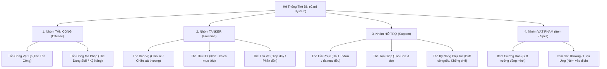
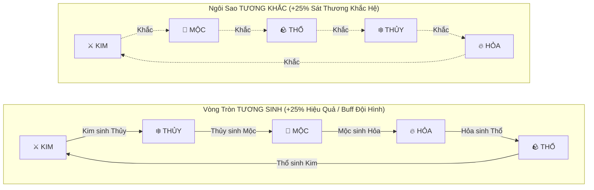
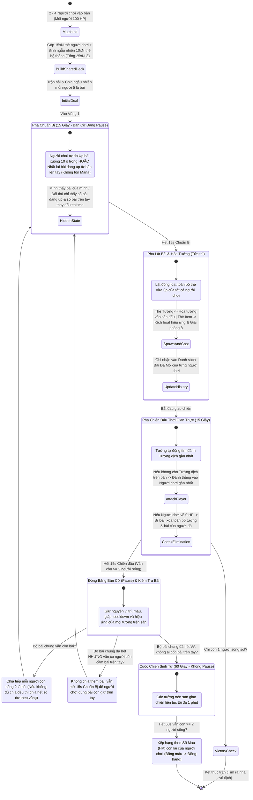

# GAME DESIGN DOCUMENT (GDD)
## Dự án: **ARCANA FIVE: HUYẾT BÀI NGŨ HÀNH** *(Working Title)*

- **Phiên bản tài liệu:** 1.0 (Full BA Specification)
- **Thể loại:** Multiplayer Tactical Card Auto-Battler kết hợp Tâm lý chiến Poker (2–4 người chơi)
- **Chủ đề & Mỹ thuật (Theme & Art Direction):** Dark Fantasy lai Á - Âu (Hiệp sĩ hắc ám, Pháp sư cổ ngữ, Linh thú nguyên tố và Cổ vật ma thuật vận hành theo quy luật Ngũ Hành Kim – Mộc – Thủy – Hỏa – Thổ trên bàn bài ma thuật).
- **Nhịp độ trận đấu:** Pha trộn giữa **Turn-based Card Bluffing (15s)** và **Real-time Auto-Combat có đóng băng trạng thái (15s)**.

---

## 1. TỔNG QUAN TRÒ CHƠI & ĐIỂM ĐỘC ĐÁO CỐT LÕI (CORE USP)

### 1.1. Tầm nhìn sản phẩm (Game Vision)
**Arcana Five** là sự giao thoa độc đáo giữa 3 trụ cột gameplay:
1. **Tâm lý chiến bàn Poker (Hidden Information, Free Place & Recall Bluffing):** Người chơi ngồi quanh bàn 4 cạnh, tự do **úp bài xuống 10 ô trước mặt hoặc nhặt lại bài đang úp từ bàn lên tay** bất cứ lúc nào khi chưa bắt đầu vòng mới (không tốn Mana). Đối thủ chỉ thấy số lượng bài bạn đang úp và số bài trên tay tăng/giảm theo thời gian thực, tạo nên các pha "All-in" (tất tay), "Fake-out" (úp bài dọa đối thủ rồi nhặt lại lên tay ở giây cuối), "Trap" (bẫy khắc hệ) hoặc "Hold" (nhử bài chờ thời).
2. **Bộ Bài Hỗn Mang Dùng Chung (Shared Chaos Deck):** Mỗi người mang 15 lá bài không trùng lặp từ bộ sưu tập cá nhân, trộn chung với bài của các đối thủ và bài ngẫu nhiên của hệ thống (`10 x Số người chơi`). Bạn có thể rút được chính lá bài chủ lực của đối thủ để dùng ngược lại họ.
3. **Chiến trường Thời gian thực Đóng băng theo Nhịp (Freeze-Frame Real-Time Battle):** Sau 15 giây chuẩn bị, bài úp đồng loạt lật mở và hóa thành Tướng hoặc kích hoạt Item ngay trên bàn. Các tướng giao chiến tự động trong 15 giây, sau đó toàn bộ chiến trường **Pause (đóng băng nguyên vị trí, máu, hiệu ứng)** để bước vào lượt rút bài và đấu trí tiếp theo.

### 1.2. Tóm tắt thông số cốt lõi (Key Game Constants)

| Thông số | Giá trị quy định | Ghi chú nghiệp vụ (BA Note) |
| :--- | :--- | :--- |
| **Số người chơi mỗi bàn** | `2 – 4 người` | Tối ưu cho chế độ Sinh tồn tự do (Free-For-All) |
| **Máu gốc người chơi (Player HP)** | `100 HP` | Về `0 HP` sẽ bị loại ngay, mất quyền chơi và xóa tướng trên bàn |
| **Số thẻ mang vào trận / người** | `15 thẻ` | Bắt buộc chọn từ Collection cá nhân, **không trùng lặp (Singleton)** |
| **Số thẻ Hệ thống cộng thêm** | `10 × N thẻ` | Với `N` là số người chơi trong bàn (`20 – 40 thẻ`) |
| **Tổng quy mô Bộ Bài Chung** | `25 × N thẻ` | 2 người: `50 lá` \| 3 người: `75 lá` \| 4 người: `100 lá` |
| **Số bài chia khởi đầu** | `5 lá / người` | Chia ngẫu nhiên lần lượt từ Bộ Bài Chung |
| **Số bài chia thêm mỗi vòng** | `2 lá / người` | Chia sau mỗi pha Pause 15s chiến đấu (khi bộ bài chung còn bài) |
| **Số ô dàn trận / người (Slots)** | `10 ô` | Giới hạn tối đa 10 ô chứa bài úp / tướng đang sống của mỗi người |
| **Chi phí sử dụng thẻ (Mana)** | `Không tốn Mana` | Tự do úp bất kỳ số lượng thẻ nào đang có trên tay vào các ô trống |
| **Thời gian Pha Chuẩn Bị (Prep)** | `15 giây` | Người chơi chọn úp bài xuống ô hoặc giữ bài trên tay |
| **Thời gian Pha Chiến Đấu (Combat)** | `15 giây` | Tướng tự động đánh mục tiêu gần nhất; hết 15s thì Pause |
| **Thời gian Tử Chiến Cuối (Sudden Death)** | `60 giây (1 phút)` | Kích hoạt khi Bộ Bài Chung hết bài VÀ không ai còn bài trên tay |

---

## 2. HỆ THỐNG PHÂN LOẠI THẺ BÀI & ĐỘ HIẾM (CARD TAXONOMY & RARITY)

### 2.1. Cấu trúc 4 Nhóm Vai Trò Chính (4 Core Archetypes)
Mọi thẻ bài trong game đều thuộc 1 trong 4 nhóm vai trò lớn (bắt buộc phải có đủ cả 4 nhóm khi chọn 15 thẻ vào trận), bên trong chia thành các lớp thẻ chuyên biệt:



#### Hệ thống 9 Chỉ Số của Mọi Thẻ Tướng & Cơ chế Skill Riêng Biệt:
Mỗi thẻ Tướng đều sở hữu **1 Kỹ Năng Riêng Biệt (Unique Skill)** cùng hệ thống **9 chỉ số** được chia làm 2 lớp hiển thị:
1. **2 Chỉ số Hiển thị Trực tiếp trên Giao diện chính (HUD trên đầu tướng & trên mặt thẻ bài):**
   - **`HP` (Máu):** Sinh lực của tướng.
   - **`Mana` (Năng lượng):** Tích lũy trong giao tranh; ngay khi đầy cây `Mana` (`Full Mana`), tướng lập tức tung **Skill riêng biệt**, sau đó `Mana` về `0`.
   - *(Ngoài ra khi tướng nhận **`Khiên` (Shield)**, lớp Khiên ảo sẽ hiển thị chồng lên thanh `HP` để chặn sát thương trước khi trừ máu thật).*
2. **7 Chỉ số Thuộc tính Chiến đấu Chi tiết (Xem khi bấm chi tiết thẻ/tướng & tính toán ngầm trong combat):**
   - **`Dame` (`ATK`):** Sát thương đòn đánh cơ bản (Vật lý hoặc Ma pháp).
   - **`Tốc độ đánh` (`ASPD`):** Số đòn đánh mỗi giây.
   - **`Tầm đánh` (`Range`):** Khoảng cách ra đòn — phân biệt rõ **Tướng đánh gần (Cận chiến)** và **Tướng đánh xa (Xạ thủ / Pháp sư / Hỗ trợ)**.
   - **`Giáp` (`Armor / DEF`):** Kháng sát thương Vật lý.
   - **`Giáp kháng phép` (`Magic Resist / MDEF`):** Kháng sát thương Ma pháp & Kỹ năng phép.
   - **`Khiên` (`Shield`):** Lớp giáp máu ảo hấp thụ sát thương (có thể có sẵn ngay khi triệu hồi hoặc tạo ra từ Skill / Thẻ Tạo Giáp / Item).
   - **`Tốc độ di chuyển` (`MSPD`):** Tốc độ di chuyển trên mặt bàn, phân bổ theo quy luật **`Tanker (Cao nhất) > Tấn Công (Trung bình) > Hỗ Trợ (Thấp nhất)`** để Tanker luôn lao lên trước tiên hứng sát thương.

1. **Nhóm Đỡ Đòn (Tanker — Hoá thành Tướng Tiên Phong trên bàn | `MSPD: Cao nhất`):**
   - Sở hữu tốc độ di chuyển nhanh nhất đội hình để luôn là người đầu tiên tiếp cận kẻ địch, trở thành mục tiêu gần nhất và hứng trọn đợt sát thương đầu.
   - **Thẻ Bảo Vệ (Guardian):** Khi đầy Mana, kích hoạt Skill tạo liên kết hộ vệ hoặc vùng chắn, gánh thay sát thương cho tướng đồng minh đứng gần.
   - **Thẻ Thu Hút (Taunter / Provoker):** Khi đầy Mana, kích hoạt Skill phát xung **Khiêu Khích (Taunt)**, ép toàn bộ tướng địch trong bán kính xung quanh phải chuyển mục tiêu sang tấn công mình.
   - **Thẻ Thủ Vệ (Sentinel):** Khi đầy Mana, kích hoạt Skill cường hóa giáp phản đòn hoặc tự hồi phục sinh lực bền bỉ tại tiền tuyến.
2. **Nhóm Tấn Công (Offense — Hoá thành Tướng DPS trên bàn | `MSPD: Trung bình`):**
   - Di chuyển theo sau Tanker để gây sát thương chủ lực khi Tanker đã vào vị trí chịu đòn.
   - **Thẻ Tấn Công Vật Lý (Physical Striker / Ranger):** Đòn đánh thường sát thương vật lý tốt; khi đầy Mana sẽ tung tuyệt kỹ trảm kích, bắn xuyên phá hoặc ám sát mục tiêu.
   - **Thẻ Tấn Công Ma Pháp (Magic Caster / Battlemage):** Đòn đánh tích Mana nhanh; khi đầy Mana sẽ tung pháp thuật nguyên tố diện rộng (AoE), sát thương bùng nổ hoặc hiệu ứng khống chế/thiêu đốt.
3. **Nhóm Hỗ Trợ (Support — Hoá thành Tướng Hỗ Trợ trên bàn | `MSPD: Thấp nhất`):**
   - Di chuyển chậm nhất để luôn giữ vị trí an toàn ở tuyến sau (Backline), tránh việc đi vượt mặt Tanker/DPS và bị kẻ địch nhắm tới.
   - **Thẻ Hồi Phục (Healer / Priest):** Khi đầy Mana, tung Skill hồi HP đơn mục tiêu hoặc đa mục tiêu cho đồng minh.
   - **Thẻ Tạo Giáp (Shielder / Warder):** Khi đầy Mana, tung Skill tạo lớp **Giáp Ảo (Shield)** hấp thụ sát thương cho đồng minh.
   - **Thẻ Kỹ Năng Phụ Trợ (Enchanter / Controller):** Khi đầy Mana, tung Skill tăng tốc đánh/công/mana cho đồng minh hoặc làm chậm/choáng/giảm giáp kẻ địch.
4. **Nhóm Vật Phẩm (Item — Kích hoạt tức thì rồi tiêu biến):**
   - **Không hóa thành tướng đứng giữ chỗ lâu dài.** Khi lật bài ở đầu pha chiến đấu, thẻ Item sẽ tung hiệu ứng ngay lập tức rồi biến mất, trả lại ô trống cho người chơi ở lượt sau.
   - **Item Cường Hóa (Buff Item):** Tự động trang bị hoặc kích hoạt lên tướng đồng minh phù hợp nhất (ví dụ: *Thánh Kiếm Cổ Ngữ* tăng 40% ATK, *Bình Huyết Dược* hồi ngay 250 HP, *Khiên Tinh Thạch* cấp lớp giáp ảo).
   - **Item Gây Hại (Offensive / Debuff Item):** Tác động thẳng lên tướng địch gần nhất hoặc cụm tướng địch đông nhất (ví dụ: *Bom Hỏa Ngục* gây sát thương nổ AoE, *Xiềng Xích Băng Giá* trói chân địch 4 giây, *Bùa Đoạt Mệnh* giảm 50% hồi máu và phá giáp).

---

### 2.2. Hệ thống 4 Bậc Độ Hiếm (Rarity Tiers: N, R, S, SSR)
Mỗi thẻ bài đều mang 1 trong 4 bậc độ hiếm. Thay vì áp đặt một khung chỉ số cố định cứng nhắc cho mọi thẻ cùng vai trò, độ hiếm định hình **Tổng Giá Trị Sức Mạnh (Total Power Budget = Chỉ số HP/Mana + Độ đột biến của Skill riêng biệt)**:
- Hai lá bài dù cùng bậc hiếm (ví dụ: cùng là **SSR Hệ Kim - Tanker**) vẫn có phân bổ chỉ số và cơ chế hoàn toàn khác nhau tùy theo thiết kế của lá bài đó (ví dụ: một lá có **HP gốc cực cao** nhưng Skill thiên về tạo giáp thụ động; lá kia có **HP gốc thấp hơn** nhưng bù lại thanh Mana ngắn hơn và **Skill tự hồi máu nhiều hơn**).

| Độ hiếm | Tên gọi | Màu sắc nhận diện | Đặc điểm Thiết kế Chỉ số & Kỹ năng (Skill) | Tỷ lệ rơi trong Pack (Đề xuất) |
| :---: | :--- | :--- | :--- | :---: |
| **N** | **Normal** (Thường) | Xám Bạc (Silver Grey) | Cấu trúc `HP`/`Mana` cân bằng, Skill riêng biệt dễ dùng và trực diện (chém mạnh đơn mục tiêu, hồi máu đơn, tạo khiên cơ bản). | `60%` |
| **R** | **Rare** (Hiếm) | Xanh Lam (Sapphire Blue) | Tổng sức mạnh nhỉnh hơn bậc N, Skill riêng biệt có thêm 1 hiệu ứng phụ trợ (làm chậm, chảy máu, phản đòn, hút máu). | `28%` |
| **S** | **Super** (Siêu Hiếm) | Tím Huyền Bí (Arcane Purple) | Phân hóa lối chơi rõ rệt (HP đột biến hoặc tích Mana cực nhanh), Skill riêng biệt có tầm ảnh hưởng diện rộng hoặc cơ chế đặc thù. | `10%` |
| **SSR** | **Super Special Rare** (Huyền Thoại) | Vàng Hoàng Kim / Đỏ Huyết (Crimson Gold) | Sở hữu **Tuyệt Kỹ Độc Bản** khi đầy Mana (khống chế diện rộng, bất tử ngắn hạn, hồi sinh/hồi máu bùng nổ, sát thương hủy diệt) được cân bằng bù trừ trực tiếp với chỉ số `HP` và `Max Mana` của riêng lá bài đó. | `2%` |

---

## 3. HỆ THỐNG NGŨ HÀNH TƯƠNG SINH – TƯƠNG KHẮC (5 ELEMENTS)

### 3.0. Nguyên lý "100 Thẻ Gốc Dùng Chung + Gắn Hệ Ngũ Hành Động" (100 Core Cards × 5 Dynamic Elements)
> **Kiến trúc Thiết kế Thẻ Bài (Thống nhất giữa Antigravity BA & Muse AI):**
> - Toàn bộ trò chơi có **cố định 100 mẫu thẻ bài gốc (`C01` đến `C100`)** với Tên thẻ, Độ hiếm (`N`, `R`, `S`, `SSR`), Chức năng, Bộ 9 chỉ số và Kỹ năng riêng biệt (`Core Skill`) cố định.
> - **Không thiết kế mỗi hệ một bộ thẻ riêng.** Thay vào đó, 100 thẻ gốc này **dùng chung cho cả 5 hệ**. Khi người chơi mở Pack hoặc khi hệ thống rút/sinh thẻ bài trong trận, lá bài đó sẽ được **gắn thêm thuộc tính Hệ Ngũ Hành (`Kim`, `Mộc`, `Thủy`, `Hỏa`, hoặc `Thổ`)**.
> - Nhờ vậy, với **100 thẻ gốc** chuẩn mực, trò chơi tự động tạo ra **`100 × 5 = 500` biến thể chiến thuật (Card × Element)**!

Khi một lá bài trong 100 thẻ gốc được gắn thuộc tính Hệ Ngũ Hành, ngoài việc kích hoạt **Tương Sinh – Tương Khắc**, bản thân đòn đánh và Skill của thẻ đó còn nhận thêm **Đặc tính Nguyên Tố (Elemental Modifier)**:

| Hệ Ngũ Hành | Phong cách Dark Fantasy | Đặc tính Nguyên Tố Cộng Thêm vào Thẻ (`Elemental Modifier`) | Khắc chế tự nhiên |
| :--- | :--- | :--- | :--- |
| **⚔️ Hệ KIM** | Thiết giáp, Kiếm khí, Thánh tích sắt | **Phá Khiên & Xuyên Phá:** Gây thêm `+35%` sát thương lên lớp `Khiên` (`Shield`) và bỏ qua `15% Giáp` của mục tiêu. | Khắc hệ Mộc & các đội hình nhiều Khiên/Giáp |
| **🌿 Hệ MỘC** | Độc dược, Rừng gai, Cổ thụ ký sinh | **Sinh Mệnh & Độc Tố:** Đòn đánh/Skill hút `10%` sát thương thành `HP` (hoặc tăng `+15%` lượng hồi máu) và gây độc nhẹ. | Khắc hệ Thổ & các trận đánh kéo dài |
| **❄️ Hệ THỦY** | Băng hà, Hải vực, Sương mù ma ảo | **Thao Túng Mana & Hàn Băng:** Đòn đánh nhận thêm `+15% Mana` tích lũy; Skill làm chậm `15%` Tốc đánh/Tốc chạy của địch trong 2s. | Khắc hệ Hỏa & các tướng phụ thuộc Skill |
| **🔥 Hệ HỎA** | Cuồng chiến, Luyện ngục, Dung nham | **Thiêu Đốt & Bùng Nổ:** Skill gây hiệu ứng Thiêu đốt (`3% HP tối đa` của mục tiêu trong 3s) và tăng `+12% Dame` gốc. | Khắc hệ Kim & đội hình co cụm đông |
| **🪨 Hệ THỔ** | Hắc thạch, Pháo đài, Trọng trường | **Kiên Cố & Chấn Động:** Khi vừa lật bài nhận ngay lớp `Khiên` bằng `10% HP tối đa` và tăng `+12% Giáp / Kháng phép`. | Khắc hệ Thủy & chống dồn sát thương (Burst) |

Mọi thẻ bài khi xuất hiện đều mang 1 trong **5 Hệ Ngũ Hành** dưới đây:
- **Hệ KIM (Metal / Ironclad):** Hiệp sĩ thiết giáp, Kiếm khí sắc bén, Thánh tích sắt thép — thiên về sát thương xuyên thấu, chí mạng và phản đòn.
- **Hệ MỘC (Wood / Sylvan Thorn):** Độc dược sư, Quái vật rừng sâu, Cổ thụ ký sinh — thiên về hồi phục sinh mệnh, hút máu, trói chân và độc tố.
- **Hệ THỦY (Water / Abyssal Frost):** Pháp sư băng hà, Hải yêu vực thẳm, Sương mù ma ảo — thiên về làm chậm, đóng băng, khống chế và hồi năng lượng.
- **Hệ HỎA (Fire / Hellfire Ash):** Cuồng chiến sĩ, Phù thủy hỏa ngục, Ác quỷ dung nham — thiên về sát thương bùng nổ (Burst), thiêu đốt diện rộng.
- **Hệ THỔ (Earth / Obsidian Stone):** Khổng lồ đá đen, Thủ vệ đại địa, Pháo đài cổ đại — thiên về sinh lực khổng lồ, tạo khiên đá và giảm sát thương.



### 3.1. Quy tắc Tương Khắc (Counter Mechanics)
- **Chuỗi khắc chế:** **Kim** khắc **Mộc** $\rightarrow$ **Mộc** khắc **Thổ** $\rightarrow$ **Thổ** khắc **Thủy** $\rightarrow$ **Thủy** khắc **Hỏa** $\rightarrow$ **Hỏa** khắc **Kim**.
- **Tác động trực tiếp trong chiến đấu:**
  1. Khi Tướng hoặc Item mang hệ **Khắc** gây sát thương lên Tướng mang hệ **Bị Khắc**: **Tăng `+25%` tổng sát thương đầu ra**.
  2. Khi Tướng hệ **Bị Khắc** đánh vào Tướng hệ **Khắc mình**: **Giảm `-15%` sát thương gây ra**.
  3. *(Lưu ý)*: Khi Tướng tấn công trực tiếp vào **Người chơi (100 HP)**, sát thương tính theo chỉ số gốc của Tướng (do Người chơi không mang hệ cố định).

### 3.2. Quy tắc Tương Sinh Kép (Dual Generation Mechanics)
- **Chuỗi tương sinh:** **Kim** sinh **Thủy** $\rightarrow$ **Thủy** sinh **Mộc** $\rightarrow$ **Mộc** sinh **Hỏa** $\rightarrow$ **Hỏa** sinh **Thổ** $\rightarrow$ **Thổ** sinh **Kim**.
- **Tác động 1 — Cộng hưởng Đội hình trên bàn (Field Synergy):**
  - Khi cùng một người chơi có ít nhất 1 Tướng hệ **A (Hệ Sinh)** và 1 Tướng hệ **B (Hệ Được Sinh)** cùng đang sống trên mặt bàn:
  - Tướng hệ **B (Được Sinh)** nhận hào quang **Nguyên Tố Tương Sinh**: **Tăng `+15%` Công/Hiệu ứng kỹ năng và nhận hồi `2% HP tối đa/giây`**.
  - Nếu người chơi凑 đủ **Ngũ Hành Tụ Hội** (có đủ 5 tướng thuộc 5 hệ Kim - Mộc - Thủy - Hỏa - Thổ cùng lúc trên sân): Toàn bộ đội hình nhận **`+25%` Toàn bộ chỉ số (All Stats) và `+20%` Giảm sát thương**.
- **Tác động 2 — Cộng hưởng Thẻ Hỗ Trợ & Item (Card Boost):**
  - Khi một Tướng Hỗ Trợ hoặc Thẻ Item thuộc hệ **A (Hệ Sinh)** tác động hiệu ứng (Hồi máu, Tạo giáp, Buff chỉ số) lên Tướng đồng minh thuộc hệ **B (Hệ Được Sinh)**: **Hiệu lực của lần Hồi máu / Tạo giáp / Buff đó được tăng thêm `+25%`**.

---

## 4. HỆ THỐNG THU THẬP, MỞ PACK & XÂY DỰNG BỘ BÀI (METAGAME & DECK BUILDING)

### 4.1. Thu thập Thẻ Bài & Mở Pack (Card Pack Gacha)
- Người chơi thu thập thẻ bài thông qua phần thưởng trận đấu, nhiệm vụ hoặc mua **Card Pack** trong cửa hàng.
- **Quy chuẩn mỗi Pack:**
  - Mỗi Pack mở ra chính xác **10 thẻ ngẫu nhiên**.
  - Có thể mở ra thẻ trùng với thẻ đã sở hữu trong Bộ sưu tập (Collection).
  - Toàn bộ thẻ mở ra (kể cả thẻ trùng) đều được lưu trữ và cộng dồn số lượng (`x1, x2, x3...`) trong **Kho Sưu Tập (Collection Inventory)** của người chơi *(phục vụ cho việc mở rộng tính năng ghép thẻ/nâng cấp/trao đổi ở các giai đoạn phát triển tiếp theo)*.
  - **Cam kết mỗi Pack (Guarantee):** Mỗi Pack 10 thẻ đảm bảo có ít nhất **1 thẻ từ bậc R trở lên**.

### 4.2. Quy tắc Chọn 15 Thẻ Vào Trận (Pre-Match Deck Selection)
Trước khi bấm tìm trận hoặc vào phòng chơi (2–4 người), người chơi phải thiết lập **Bộ Bài Xuất Chiến (Loadout Deck)** gồm đúng **15 thẻ** từ bộ sưu tập của mình:

1. **Quy tắc Không Trùng Lặp (Singleton Rule):**
   - Trong 15 thẻ được chọn, **không được phép có 2 thẻ trùng ID** (mỗi loại thẻ chỉ được đưa vào tối đa 1 lá, dù trong kho có nhiều bản sao).
   - Quy tắc này đảm bảo mỗi ván đấu có độ biến thiên cao, không ai có thể spam 15 lá giống hệt nhau.
2. **Quy tắc Đủ Vai Trò Bắt Buộc (Role Balance Validation):**
   - Để nút **"Sẵn Sàng / Vào Trận"** được kích hoạt, 15 lá bài bắt buộc phải có mặt đầy đủ cả **4 nhóm vai trò** với số lượng tối thiểu như sau:
     - **Nhóm Tấn Công (Vật lý / Ma pháp):** Tối thiểu `2 thẻ`
     - **Nhóm Tanker (Bảo vệ / Thu hút / Thủ vệ):** Tối thiểu `2 thẻ`
     - **Nhóm Hỗ Trợ (Hồi phục / Tạo giáp / Buff):** Tối thiểu `2 thẻ`
     - **Nhóm Vật Phẩm (Item Buff / Item Sát thương):** Tối thiểu `2 thẻ`
     - **7 vị trí còn lại:** Người chơi tự do phối hợp bất kỳ nhóm nào theo ý đồ chiến thuật cá nhân.

---

## 5. LUỒNG TRẬN ĐẤU & QUY TẮC VẬN HÀNH CHI TIẾT (CORE MATCH LOOP)

### 5.1. Sơ đồ Trạng thái Ván đấu (Match State Machine)



---

### 5.2. Quy tắc Khởi tạo Bộ Bài Chung (Shared Chaos Deck)
Khi trận đấu bắt đầu với $N$ người chơi ($N \in \{2, 3, 4\}$):
1. **Thu gom bài người chơi:** Hệ thống lấy $15$ thẻ đã chọn của mỗi người chơi gộp lại thành $15 \times N$ thẻ.
2. **Sinh bài ngẫu nhiên từ Hệ thống:** Hệ thống tự động sinh ngẫu nhiên thêm $10 \times N$ thẻ bài từ toàn bộ kho thẻ chuẩn của game.
   - *Quy tắc phân bổ bài hệ thống:* Để tránh lệch pha, trong mỗi cụm 10 thẻ hệ thống sẽ đảm bảo có ít nhất 2 thẻ Tấn công, 2 thẻ Tanker, 2 thẻ Hỗ trợ, 2 thẻ Item và phân bổ ngẫu nhiên theo tỷ lệ độ hiếm chuẩn.
3. **Trộn bài & Chia bài đầu trận:**
   - Tổng số lá bài trong Bộ Bài Chung (Draw Pile) là:
     $$\text{Total Cards} = 15N + 10N = 25N \text{ lá}$$
     *(Cụ thể: 2 người = 50 lá; 3 người = 75 lá; 4 người = 100 lá).*
   - Hệ thống xáo trộn hoàn toàn bộ bài chung và chia ngẫu nhiên lần lượt cho mỗi người chơi **5 lá bài khởi đầu**.
   - **Hệ quả chiến thuật:** Vì mọi lá bài được trộn chung, người chơi hoàn toàn có thể bốc được lá bài SSR mạnh nhất mà đối thủ mang vào, hoặc nhìn những lá bài mình bốc được để đoán xem đối thủ đã mang đội hình hệ gì vào trận!

---

### 5.3. Pha Chuẩn Bị 15 Giây & Cơ chế Úp / Nhặt Lại Bài Kiểu Poker (15s Preparation Phase)
Trong suốt thời gian trước khi bắt đầu vòng chiến đấu tiếp theo (khi các lá bài mới đặt vẫn đang ở trạng thái **Úp** chưa lật):
1. **Thao tác Úp xuống & Nhặt lại tự do (Free Place & Recall to Hand):**
   - Người chơi nhìn thấy rõ mặt ngửa của các lá bài trên tay mình.
   - **Úp bài xuống bàn:** Người chơi có thể kéo/chạm để **úp bất kỳ số lượng lá bài nào** từ trên tay xuống các ô trống trong **10 ô trước mặt mình** (không tốn Mana).
   - **Nhặt lại bài từ bàn lên tay (Recall / Pick back up):** Khi chưa bước sang vòng mới (chưa hết 15s chuẩn bị để lật bài), người chơi có thể **chạm hoặc kéo bất kỳ lá bài nào đang úp trên bàn để nhặt lại về trên tay**, hoặc đổi vị trí lá bài đang úp từ ô này sang ô trống khác **không giới hạn số lần**.
   - **Giữ bài chờ thời (Hold):** Người chơi có toàn quyền giữ lại bài trên tay (không bắt buộc phải úp hết) để chờ các vòng tiếp theo.
   - *Lưu ý phân biệt:* Chỉ những lá bài **đang úp (chưa mở)** mới nhặt lại lên tay được; những ô đã lật từ các vòng trước và đã hóa thành Tướng đang chiến đấu trên bàn thì không thể nhặt lại.
2. **Cơ chế Ẩn Thông Tin & Đòn Tâm Lý "Nhấp Nhả" (Fog of Card & Fake-out Bluffing):**
   - **Bản thân người chơi:** Nhìn thấy rõ thông tin, hình ảnh, hệ và chỉ số của các lá bài mình đang úp trên 10 ô cũng như bài đang cầm trên tay.
   - **Những người chơi khác:**
     - Chỉ nhìn thấy **mặt lưng úp** của các lá bài bạn đang đặt trên bàn (biết bạn đang úp bao nhiêu lá, ở những ô nào, nhưng **tuyệt đối không biết đó là thẻ gì**).
     - Nhìn thấy chính xác **số lượng lá bài còn lại trên tay** của bạn tăng/giảm ngay lập tức mỗi khi bạn úp bài xuống hoặc nhặt bài từ bàn lên tay.
   - **Chiến thuật Mind-game:** Nhờ cơ chế cho phép nhặt lại bài trước khi qua lượt, người chơi có thể tung đòn tâm lý: cố tình úp liền 4–5 lá xuống bàn để dọa đối thủ rằng mình sắp "All-in" (ép đối thủ phải vội vàng úp hết bài phòng thủ/item ra), sau đó ở những giây cuối trước khi hết 15s thì **nhặt lại bài từ bàn lên tay** để bảo toàn lực lượng!
3. **Quy tắc giới hạn 10 ô (10-Slot Cap):**
   - Mỗi người chơi có đúng **10 ô** trước mặt.
   - Mỗi Tướng đang còn sống trên chiến trường của người chơi đó sẽ chiếm giữ **1 ô tương ứng** (hiển thị trạng thái liên kết với tướng trên bàn).
   - Nếu một tướng trên bàn bị hạ gục trong pha chiến đấu, ô của tướng đó lập tức trở về trạng thái **Ô Trống** ở lượt sau.
   - Do đó, số lá bài tối đa người chơi có thể úp thêm trong lượt mới bằng: `10 - (Số tướng của mình đang còn sống trên bàn)`.

---

### 5.4. Pha Lật Bài, Hóa Tướng & Kích Hoạt Item (Reveal & Resolution Phase)
Ngay khi đồng hồ đếm ngược 15 giây chuẩn bị về `00:00`:
1. **Lật mở đồng loạt (Simultaneous Flip):**
   - Tất cả những lá bài đang úp của mọi người chơi trên bàn cùng lúc lật ngửa lên với hiệu ứng ánh sáng theo cấp độ hiếm (N / R / S / SSR) và hệ Ngũ Hành.
2. **Ghi nhận vào Lịch sử Bài Đã Mở (Revealed Card History):**
   - Ngay khi lá bài được lật ra, hệ thống lưu lá bài đó vào **Danh sách Bài Đã Sử Dụng (Played History)** của người chơi đó.
   - Bất kỳ lúc nào trong trận, người chơi đều có thể bấm vào biểu tượng của đối thủ để xem toàn bộ những lá bài đối thủ đã từng lật từ đầu trận đến giờ.
3. **Xử lý theo Loại Thẻ:**
   - **Nếu là Thẻ Tướng (Tấn Công / Tanker / Hỗ Trợ):**
     - Lá bài hóa thành mô hình Tướng 2D trên chiến trường tại rìa khu vực của người chơi đó (tương ứng với vị trí ngang của ô bài).
     - Ô bài đó chuyển sang trạng thái **"Đang duy trì Tướng"** cho đến khi tướng đó tử trận.
   - **Nếu là Thẻ Vật Phẩm (Item Buff / Item Sát Thương):**
     - **Item Buff (Cường hóa/Hồi phục/Tạo giáp):** Tự động bay tới kích hoạt lên Tướng đồng minh của người chơi đó đang có trên bàn (ưu tiên tướng vừa xuất hiện gần ô đặt Item nhất; nếu đặt cạnh một tướng cụ thể thì ưu tiên tướng đó). *Lưu ý:* Nếu người chơi úp thẻ Item Buff mà trên bàn mình không có bất kỳ tướng đồng minh nào (kể cả tướng vừa lật cùng lượt), thẻ Item sẽ phát nổ vô hiệu và vẫn bị tiêu hao.
     - **Item Sát Thương / Hiệu Ứng (Debuff/Damage):** Tự động phóng tới Tướng địch gần nhất trên bàn (hoặc cụm tướng địch đông nhất đối với Item AoE). Nếu trên bàn hoàn toàn không có tướng địch nào, Item gây sát thương có thể đánh thẳng vào Người chơi địch gần nhất (với `50%` hiệu lực sát thương).
     - Sau khi kích hoạt xong hiệu ứng, thẻ Item biến mất khỏi bàn và **trả lại Ô Trống ngay lập tức**.

---

### 5.5. Pha Chiến Đấu 15 Giây & Đóng Băng Bàn Cờ (15s Action Phase & Freeze)
Sau khi lật bài và hóa tướng xong, đồng hồ chuyển sang **15 giây Chiến Đấu (Action Phase)**:

1. **Hành vi AI của Tướng & Quy luật Tốc Độ Di Chuyển trên bàn (Real-time Auto-Battler AI):**
   - **Thứ tự Tốc độ Di chuyển (`Tanker > Tấn Công > Hỗ Trợ`):**
     - **Tanker (`MSPD ~ 140 - 160 px/s`):** Lao lên nhanh nhất ngay khi lật bài để chiếm lĩnh tiền tuyến, giúp bản thân trở thành **mục tiêu gần nhất** trong tầm quét của tướng địch và hứng sát thương đầu tiên.
     - **Tấn Công (`MSPD ~ 105 - 125 px/s`):** Di chuyển tốc độ trung bình (Cận chiến vật lý đi nhanh hơn Ma pháp/Xạ thủ một nhịp), bám sát ngay sau lưng Tanker để xả sát thương khi Tanker đã tiếp chiến.
     - **Hỗ Trợ (`MSPD ~ 75 - 90 px/s`):** Di chuyển chậm nhất và có tầm thi triển kỹ năng xa, tự nhiên lùi lại tuyến sau (Backline) để bơm máu, tạo giáp và buff cho tiền tuyến.
   - **Logic Chọn Mục Tiêu & Tầm Đánh (`Range` - Đánh Gần vs Đánh Xa):**
     - Mọi tướng tự động quét tìm **Tướng địch gần nhất** trên bàn cờ.
     - **Tướng Đánh Gần (Cận chiến - `Range: 1.0 – 1.5`):** Di chuyển áp sát trực tiếp mục tiêu rồi mới vung vũ khí tấn công.
     - **Tướng Đánh Xa (Viễn chiến - `Range: 3.5 – 5.5`):** Ngay khi kẻ địch gần nhất lọt vào bán kính `Tầm đánh`, tướng sẽ dừng bước và đứng từ xa xả đạn/phép mà không cần lao vào giữa đám đông.
     - *Ngoại lệ Khiêu Khích (Taunt):* Nếu bị dính hiệu ứng từ **Thẻ Thu Hút**, tướng bắt buộc phải chuyển mục tiêu sang đánh tướng Thu Hút đó.
   - **Cơ chế Tính Sát Thương (`Dame`, `Giáp`, `Giáp Kháng Phép`, `Khiên`):**
     - **Sát thương Vật lý** bị giảm trừ bởi chỉ số **`Giáp` (`DEF`)** của mục tiêu.
     - **Sát thương Ma pháp** bị giảm trừ bởi chỉ số **`Giáp kháng phép` (`MDEF`)** của mục tiêu.
     - Công thức giảm trừ chuẩn:
       $$\text{Sát thương thực} = \text{Dame gốc} \times \left(\frac{100}{100 + \text{Giáp hoặc Giáp kháng phép}}\right) \times \text{Hệ số Ngũ Hành}$$
     - **Ưu tiên trừ `Khiên` (`Shield`) trước `HP`:** Nếu mục tiêu đang có chỉ số **`Khiên` (`Shield > 0`)**, sát thương thực sẽ trừ vào `Khiên` trước; phần sát thương vượt quá lớp `Khiên` mới trừ vào `HP` gốc.
   - **Cơ chế Thanh `HP` & `Mana` (Hiển thị trực tiếp trên UI) và Kích hoạt Skill Riêng Biệt:**
     - Mỗi tướng trên sân hiển thị 2 thanh trạng thái: **Thanh Máu (`HP`)** và **Thanh Năng Lượng (`Mana`)** (khởi đầu ở `0 Mana`, hoặc có một lượng Mana khởi điểm tùy thẻ bài).
     - Tướng tích lũy `Mana` khi tung đòn đánh thường (ví dụ `+10 Mana/đòn`), khi nhận sát thương (đặc biệt với Tanker) hoặc tự hồi theo giây (với Pháp sư/Hỗ trợ).
     - **Khi `Mana` chạm ngưỡng tối đa (`Max Mana` riêng của từng thẻ): Tướng lập tức thi triển `Skill Riêng Biệt` của mình**, sau đó thanh `Mana` về `0` và bắt đầu chu kỳ tích lũy mới.
   - **Tấn công trực tiếp Người Chơi (Direct Player Hit):**
     - Khi trên toàn bộ mặt bàn **không còn bất kỳ Tướng địch nào sống sót** (hoặc tất cả đối thủ đều trống bàn), các Tướng của bạn sẽ lập tức di chuyển về phía **cạnh bàn của Người chơi địch còn sống gần nhất** và tấn công trực tiếp vào thanh máu `100 HP` của người chơi đó!
     - Để quy đổi cân bằng với mốc `100 HP` của người chơi, mỗi đòn đánh của Tướng vào thẳng Người chơi sẽ gây sát thương cơ bản theo bậc hiếm và vai trò (ví dụ: Tướng N gây `3 HP/đòn`, R gây `4 HP/đòn`, S gây `6 HP/đòn`, SSR gây `8 HP/đòn`).

2. **Quy tắc Hạ Gục Người Chơi (Player Elimination):**
   - Mỗi người chơi khởi đầu với **`100 HP`**.
   - Ngay khoảnh khắc HP của một người chơi giảm về **`0 HP`**:
     - Người chơi đó **Thua Trận (Eliminated)** ngay lập tức (ghi nhận thứ hạng theo thời điểm bị loại).
     - Toàn bộ Tướng của người chơi đó đang còn trên mặt bàn **tan biến ngay lập tức**.
     - Toàn bộ lá bài còn cầm trên tay hoặc đang úp của người chơi đó bị hủy bỏ, không còn quyền thao tác.
     - Các tướng của những người chơi còn lại sẽ lập tức chuyển mục tiêu sang đối thủ còn sống tiếp theo.

3. **Cơ chế Đóng Băng sau 15 giây (Board Pause / Freeze State):**
   - Khi hết 15 giây chiến đấu mà vẫn còn từ 2 người chơi trở lên sống sót:
   - Chiến trường lập tức **PAUSE (Đóng băng toàn bộ)**:
     - Giữ nguyên **tọa độ vị trí `(x, y)`** hiện tại của mọi tướng trên mặt bàn.
     - Giữ nguyên **lượng `HP` hiện tại, lượng `Mana` đang tích dở (ví dụ `70/100 Mana`), lượng Giáp ảo (Shield)** và **thời gian còn lại của mọi hiệu ứng Skill/Buff/Debuff** trên người các tướng để bước sang vòng tiếp theo.
   - Trong lúc bàn cờ đang Pause, hệ thống tiến hành kiểm tra Bộ Bài Chung để chuyển sang lượt tiếp theo.

---

### 5.6. Quy tắc Chia Bài Tiếp Theo, Hết Bài & Cuộc Chiến 1 Phút (Endgame Rules)
Sau mỗi lần Pause 15s chiến đấu, hệ thống xét 3 trạng thái của **Bộ Bài Chung (Deck)** và **Bài Trên Tay (Hand)**:

| Trạng thái | Điều kiện kiểm tra | Hành động của Hệ thống |
| :--- | :--- | :--- |
| **Trạng thái 1: Còn bài trong Bộ Bài Chung** | `Deck > 0` | Chia ngẫu nhiên cho mỗi người chơi còn sống **2 lá bài tiếp theo** (nếu số bài còn lại trong bộ bài ít hơn `2 × Số người còn sống`, chia lần lượt từng lá một cho đến khi cạn sạch). Sau đó mở **15s Chuẩn Bị** như bình thường. |
| **Trạng thái 2: Hết bài rút, nhưng còn người giữ bài trên tay** | `Deck == 0` VÀ `Có ít nhất 1 người còn sống có Hand > 0` | **Không chia thêm bài**, nhưng **vẫn bắt buộc Pause bàn cờ sau mỗi 15s chiến đấu** và mở **15s Chuẩn Bị** để những người còn giữ bài trên tay có cơ hội úp bài xuống bàn. |
| **Trạng thái 3: Hết sạch bài rút VÀ không ai còn bài trên tay** | `Deck == 0` VÀ `Tất cả người chơi còn sống đều có Hand == 0` (sau khi đã lật hết bài úp) | Kích hoạt ngay **CUỘC CHIẾN SINH TỬ 1 PHÚT (60s Final Showdown)**: Bàn cờ **không còn Pause mỗi 15s nữa**, các tướng còn lại trên bàn chiến đấu liên tục trong tối đa **60 giây**. |

#### Phân định thắng thua sau 60 giây Tử Chiến (Tie-breaker Resolution):
- Nếu trong 60 giây có tất cả đối thủ bị hạ về `0 HP` $\rightarrow$ Người sống sót cuối cùng chiến thắng tuyệt đối (**Top 1**).
- Nếu hết **60 giây (1 phút)** mà vẫn còn từ 2 người chơi trở lên sống sót (hoặc toàn bộ tướng của mọi bên đều đã chết hết mà không ai mất hết máu):
  1. Hệ thống xét **Số máu (HP) còn lại** của từng người chơi còn sống: Ai có **HP cao hơn sẽ xếp hạng cao hơn** (ví dụ: Người A còn `65 HP` đạt Hạng 1, Người B còn `40 HP` đạt Hạng 2).
  2. Nếu hai hoặc nhiều người chơi có **cùng số máu còn lại bằng nhau** (ví dụ cùng còn `50 HP`): **Xếp Đồng Hạng (Shared Rank / Tie)**!

---

## 6. THIẾT KẾ BÀN CHƠI KIỂU POKER & GIAO DIỆN UI/UX (POKER TABLE LAYOUT)

### 6.1. Sơ đồ Bố cục Mặt Bàn 4 Cạnh (4-Edge Poker Table Layout)
Bàn chơi được thiết kế theo góc nhìn từ trên xuống (Top-down / 3/4 nghiêng nhẹ như bàn Poker sang trọng trong hầm ngục Dark Fantasy):

```
+-----------------------------------------------------------------------------------+
|                        [ĐỐI THỦ 2 - CẠNH TRÊN (TOP)]                              |
|         ❤️ HP: 85/100  |  🎴 Bài trên tay: 4 lá  |  📜 [Xem bài đã mở (6)]         |
|     [Ô1] [Ô2] [Ô3] [Ô4] [Ô5] [Ô6] [Ô7] [Ô8] [Ô9] [Ô10]  (10 Ô bài đối thủ 2)      |
+-----------------------------------------------------------------------------------+
| [ĐỐI THỦ 1]  |                                                     | [ĐỐI THỦ 3]  |
| CẠNH TRÁI    |         ===================================         | CẠNH PHẢI    |
| ❤️ 100/100   |         |                                 |         | ❤️ 42/100    |
| 🎴 Tay: 3 lá |  [Ô1]   |     KHU VỰC CHIẾN TRƯỜNG        |  [Ô1]   | 🎴 Tay: 1 lá |
| 📜 [Đã mở(8)]|  [Ô2]   |         TRUNG TÂM               |  [Ô2]   | 📜 [Đã mở(9)]|
|              |  [Ô3]   |    (CENTRAL BATTLE ARENA)       |  [Ô3]   |              |
|              |  [Ô4]   |                                 |  [Ô4]   |              |
|              |  [Ô5]   |   🐉 Tướng di chuyển tự do      |  [Ô5]   |              |
|              |  [Ô6]   |   ⚔️ Đánh địch gần nhất         |  [Ô6]   |              |
|              |  [Ô7]   |   ⏸️ Pause giữ vị trí sau 15s   |  [Ô7]   |              |
|              |  [Ô8]   |                                 |  [Ô8]   |              |
|              |  [Ô9]   |   [Bộ bài chung còn: 42 lá]     |  [Ô9]   |              |
|              |  [Ô10]  |   [⏱️ Đếm ngược: 15s / 60s]     |  [Ô10]  |              |
|              |         ===================================         |              |
+-----------------------------------------------------------------------------------+
|     [Ô1] [Ô2] [Ô3] [Ô4] [Ô5] [Ô6] [Ô7] [Ô8] [Ô9] [Ô10]  (10 Ô của BẠN - Nhìn rõ)  |
|         ❤️ HP: 92/100  |  🔥 Ngũ Hành Đội Hình  |  📜 [Xem bài đã mở của bàn]     |
|   +---------------------------------------------------------------------------+   |
|   |  🎴 BÀI TRÊN TAY CỦA BẠN (Nhìn rõ mặt bài): [Lá 1] [Lá 2] [Lá 3] [Lá 4]  |   |
|   +---------------------------------------------------------------------------+   |
|                        [NGƯỜI CHƠI CHÍNH - CẠNH DƯỚI (BOTTOM)]                    |
+-----------------------------------------------------------------------------------+
```

### 6.2. Chi tiết Hiển thị của 10 Ô Bài (10-Slot Visual States)
Mỗi người chơi có 1 dãy **10 ô (Slots)** chạy dọc theo cạnh bàn của mình. Mỗi ô có 4 trạng thái trực quan:
1. **Trạng thái 1 — Ô Trống (Empty Slot):** Khung đá cổ ngữ tối màu, sẵn sàng nhận bài kéo xuống.
2. **Trạng thái 2 — Đang Úp Bài (Face-Down Card - Khi chưa sang lượt tiếp theo):**
   - **Với chủ sở hữu (Bạn):** Hiển thị lá bài hơi nghiêng kèm hình thu nhỏ + viền sáng Ngũ Hành để bạn biết rõ mình đang úp lá gì ở ô nào. Có thể **chạm hoặc kéo ngược về tay để nhặt lại bài lên tay** (hoặc kéo sang ô trống khác) bất cứ lúc nào trước khi hết 15s chuẩn bị.
   - **Với 3 người chơi khác:** Chỉ hiển thị **mặt lưng lá bài bí ẩn** đang úp (không lộ hệ, không lộ độ hiếm, không lộ loại thẻ). Nếu bạn nhặt lại lá bài lên tay, đối thủ sẽ thấy mặt lưng bài ở ô đó biến mất (ô trống trở lại) và số đếm bài trên tay bạn tăng thêm `+1`.
3. **Trạng thái 3 — Đang Duy Trì Tướng (Active Hero Linked):**
   - Khi bài đã lật và hóa thành Tướng chạy vào giữa bàn, ô đó sáng biểu tượng thu nhỏ của Tướng đó + thanh HP mini đồng bộ với Tướng ngoài sân. Khi Tướng chết, ô nổ hiệu ứng tan biến và quay về **Ô Trống**.
4. **Trạng thái 4 — Kích Hoạt Item (Item Triggering):**
   - Khi lật ra thẻ Item, ô bùng sáng hiệu ứng phóng tia phép vào mục tiêu rồi lập tức dọn sạch về **Ô Trống**.

### 6.3. Bảng Tra Cứu Bài Đã Mở (Revealed Cards History Modal)
- Cạnh avatar của mỗi người chơi có nút **`📜 Đã mở (X)`**.
- Khi bấm vào, một cửa sổ pop-up nhỏ hiện ra danh sách toàn bộ các thẻ mà người chơi đó đã lật từ đầu trận đến hiện tại (phân nhóm theo Tướng còn sống, Tướng đã chết, và Item đã dùng).
- Tính năng này phục vụ trực tiếp lối chơi **Đếm bài (Card Counting)**: Vì mỗi người chỉ mang 15 thẻ không trùng lặp, càng về cuối trận người chơi tinh ý càng đoán được những lá bài chủ lực nào vẫn chưa xuất hiện!

---

## 7. HỆ THỐNG 9 CHỈ SỐ & BỘ 100 THẺ BÀI GỐC ĐẦY ĐỦ (`C01` – `C100`)

*(Được đồng thiết kế & cân bằng thông số qua 3 vòng thảo luận chuyên sâu giữa **Antigravity BA** và **Muse AI `muse-spark`**)*

### 7.1. Đặc tả Đầy Đủ 9 Chỉ Số Của Mỗi Tướng & Quy tắc Hiển thị Giao diện

Để giao diện bàn chơi 4 người luôn thoáng đãng, dễ nhìn nhưng vẫn giữ trọn chiều sâu chiến thuật, 9 chỉ số của mỗi Tướng được chia làm **2 nhóm hiển thị**:

| STT | Tên Chỉ Số | Ký hiệu | Phân loại Hiển thị trên UI | Vai trò & Cơ chế Vận hành |
| :-: | :--- | :---: | :--- | :--- |
| 1 | **Máu (Sinh lực)** | `HP` | **Hiển thị trực tiếp** (Thanh màu Xanh/Đỏ trên đầu tướng & trên thẻ) | Lượng máu của tướng; về `0` thì tướng tử trận và giải phóng ô bài. |
| 2 | **Năng lượng kỹ năng** | `Mana` | **Hiển thị trực tiếp** (Thanh màu Lam ngay dưới thanh HP) | Tích lũy khi đánh/nhận đòn; khi đầy (`Mana == Max Mana`) sẽ tung **Skill riêng biệt**. |
| 3 | **Khiên (Giáp ảo)** | `Khiên` (`Shield`) | **Hiển thị trực tiếp trên thanh HP** (Vạch màu Trắng/Vàng bọc ngoài HP khi `> 0`) | Lớp máu ảo hấp thụ sát thương trước khi trừ vào `HP`. Có thể có sẵn từ đầu hoặc do Skill/Item tạo ra. |
| 4 | **Sát thương** | `Dame` (`ATK`) | Xem ở bảng Chi tiết thẻ/tướng (Hover/Tap) | Lượng sát thương cơ bản của mỗi đòn đánh thường (Vật lý hoặc Ma pháp). |
| 5 | **Tốc độ đánh** | `ASPD` | Xem ở bảng Chi tiết thẻ/tướng | Số đòn tấn công thực hiện trong 1 giây (ví dụ: `0.9/s`, `1.2/s`, `1.5/s`). |
| 6 | **Tầm đánh** | `Range` | Xem ở bảng Chi tiết thẻ/tướng | Khoảng cách ra đòn: **Đánh gần / Cận chiến** (`1.0 – 1.5 ô`) hoặc **Đánh xa / Viễn chiến** (`3.5 – 5.5 ô`). |
| 7 | **Giáp vật lý** | `Giáp` (`DEF`) | Xem ở bảng Chi tiết thẻ/tướng | Giảm sát thương từ các đòn đánh và kỹ năng **Vật lý**. |
| 8 | **Giáp kháng phép** | `Kháng phép` (`MDEF`) | Xem ở bảng Chi tiết thẻ/tướng | Giảm sát thương từ các đòn đánh và kỹ năng **Ma pháp / Nguyên tố**. |
| 9 | **Tốc độ di chuyển** | `MSPD` | Xem ở bảng Chi tiết thẻ/tướng | Tốc độ chạy trên bàn cờ theo quy luật: **`Tanker (Cao nhất) > Tấn Công > Hỗ Trợ (Thấp nhất)`**. |

---

### 7.2. Tổng kết Thảo luận Chuyên môn giữa 2 AI (Antigravity BA × Muse AI) cho Bộ 100 Thẻ

1. **Phân bổ Đối xứng Tuyệt đối `5 Nhóm × 20 Thẻ = 100 Thẻ Gốc` (`500 Biến thể Ngũ Hành`):**
   - Mỗi nhóm trong 5 nhóm (**Tấn Công Vật Lý**, **Tấn Công Ma Pháp**, **Tanker**, **Hỗ Trợ**, **Item**) đều có đúng **20 thẻ** với tỷ lệ độ hiếm đồng nhất: **`6 N` + `6 R` + `5 S` + `3 SSR` = 20 thẻ/nhóm**.
   - Tổng toàn game: **`30 N` (30%) · `30 R` (30%) · `25 S` (25%) · `15 SSR` (15%) = 100 Thẻ Gốc**.
2. **Thang Độ Phức Tạp Kỹ Năng Theo Độ Hiếm (Complexity Scaling):**
   - **Bậc N (`30 thẻ`):** Kỹ năng 1 hiệu ứng trực diện, dễ đọc, chỉ số cơ bản vững chắc.
   - **Bậc R (`30 thẻ`):** Kỹ năng có thêm 1 điều kiện kích hoạt, cộng dồn (stack) hoặc quy tắc chọn mục tiêu thông minh.
   - **Bậc S (`25 thẻ`):** Kỹ năng tác động vùng diện rộng (AoE), đa mục tiêu hoặc chuyển đổi tài nguyên (`HP` $\leftrightarrow$ `Khiên` $\leftrightarrow$ `Mana`).
   - **Bậc SSR (`15 thẻ`):** Kỹ năng **Đột biến / Phá luật** (`Execute`, `SoulHarvest`, `ManaDrain`, `InvertHeal`, `SwapHP`, `ReflectShield`, `UndyingLink`, `TimeRewind`, `ElementShift`...) — mỗi tag phá luật chỉ xuất hiện tối đa 1–2 lần trong toàn bộ 100 thẻ.
3. **Quy luật Bù trừ Ngân sách Sức mạnh (Power Budget Discipline):**
   - Cùng bậc hiếm và cùng vai trò, thẻ nào có Skill càng đột biến hoặc `Max Mana` càng ngắn thì tổng chỉ số thô (`HP`, `Dame`, `Giáp`) sẽ thấp hơn thẻ có Skill đơn giản.
4. **Vòng tròn Khắc chế Cơ chế (Counter Loop):**
   - **Phá Khiên** (`C18, C98`) $\rightarrow$ khắc **Tạo Khiên Dày** (`C41, C53, C57, C73`) $\rightarrow$ khắc **Đảo/Giảm Hồi Máu** (`C39, C89` vì Khiên không tính là HP hồi) $\rightarrow$ khắc **Hồi Máu Mạnh** (`C14, C61, C67`) $\rightarrow$ khắc **Phản Sát Thương** (`C47, C58, C99`) $\rightarrow$ khắc **Tốc Đánh / Dồn Dame** (`C06, C07, C13`) $\rightarrow$ khắc **Hút/Khóa Mana** (`C38, C89, C91`) $\rightarrow$ khắc **Pháp Sư / Hỗ Trợ chờ Skill** (`C33, C74, C79, C80`).

---

### 7.3. Danh Mục Đầy Đủ 100 Thẻ Bài Gốc (`C01` – `C100`)

*(Lưu ý: Mọi thẻ dưới đây đều là **Thẻ Gốc dùng chung**. Khi mở Pack hoặc rút bài trong trận, hệ thống sẽ gắn động 1 trong 5 hệ **`[Kim | Mộc | Thủy | Hỏa | Thổ]`** lên thẻ).*

#### NHÓM 1: TẤN CÔNG VẬT LÝ (`C01` – `C20` | 20 Thẻ: 6 N, 6 R, 5 S, 3 SSR)

| Mã | Tên Thẻ Bài Gốc | Hiếm | Phân Loại / Tag | UI Trực Tiếp (`HP` · `Mana` · `Khiên`) | Công (`Dame` · `ASPD` · `Tầm đánh`) | Thủ & Tốc (`Giáp` · `K.Phép` · `MSPD`) | Skill Riêng Biệt (Kích hoạt khi đầy `Mana`) |
| :-: | :--- | :-: | :--- | :---: | :---: | :---: | :--- |
| `C01` | **Hắc Kiếm Tàn Binh** | **N** | Cận chiến · `SingleHit` | `HP: 250` · `Mana: 55` · `Khiên: 0` | `Dame: 36` · `ASPD: 1.20/s` · `Range: 1.2 (Gần)` | `Giáp: 25` · `K.Phép: 15` · `MSPD: 125` | **Trọng Trảm:** Chém mạnh vào kẻ địch gần nhất gây `160% Dame` vật lý và xuyên `20% Giáp`. |
| `C02` | **Nỏ Thủ Câm Lặng** | **N** | Xạ thủ · `SnipeFar` | `HP: 200` · `Mana: 50` · `Khiên: 0` | `Dame: 34` · `ASPD: 1.25/s` · `Range: 4.8 (Xa)` | `Giáp: 15` · `K.Phép: 15` · `MSPD: 110` | **Tiễn Xuyên Tâm:** Bắn mũi tên xuyên gió vào kẻ địch **xa nhất** trên bàn, gây `155% Dame` vật lý. |
| `C03` | **Đao Phủ Đồi Thi** | **N** | Đấu sĩ · `MeleeAoE` | `HP: 280` · `Mana: 65` · `Khiên: 20` | `Dame: 33` · `ASPD: 1.05/s` · `Range: 1.3 (Gần)` | `Giáp: 28` · `K.Phép: 18` · `MSPD: 120` | **Xoáy Trảm:** Vung đại đao xoay tròn gây `115% Dame` vật lý lên toàn bộ kẻ địch đứng xung quanh. |
| `C04` | **Kỵ Binh Gỉ Sét** | **N** | Đột kích · `Knockback` | `HP: 265` · `Mana: 60` · `Khiên: 30` | `Dame: 32` · `ASPD: 1.15/s` · `Range: 1.4 (Gần)` | `Giáp: 30` · `K.Phép: 15` · `MSPD: 135` | **Lao Kích:** Húc thẳng vào mục tiêu hiện tại gây `140% Dame` vật lý và đẩy lùi nhẹ kèm choáng `0.8s`. |
| `C05` | **Trảm Thủ Vô Danh** | **N** | Phá Giáp · `AntiArmor` | `HP: 260` · `Mana: 60` · `Khiên: 15` | `Dame: 35` · `ASPD: 1.15/s` · `Range: 1.3 (Gần)` | `Giáp: 26` · `K.Phép: 16` · `MSPD: 125` | **Đoạn Cốt:** Bổ mạnh vào kẻ địch có `Giáp` cao nhất trong tầm, gây `170% Dame` vật lý và bỏ qua `35% Giáp`. |
| `C06` | **Du Kích Nỏ Liên Châu** | **N** | Xạ thủ · `MultiHit` | `HP: 195` · `Mana: 45` · `Khiên: 0` | `Dame: 30` · `ASPD: 1.35/s` · `Range: 4.5 (Xa)` | `Giáp: 14` · `K.Phép: 16` · `MSPD: 115` | **Liên Xạ:** Bắn 2 phát tên liên tiếp vào kẻ địch gần nhất (mỗi phát `85% Dame`), kích hoạt 2 lần hiệu ứng Hệ. |
| `C07` | **Song Đao Huyết Cuồng** | **R** | Tốc đánh · `ASPDStack` | `HP: 260` · `Mana: 50` · `Khiên: 0` | `Dame: 35` · `ASPD: 1.35/s` · `Range: 1.2 (Gần)` | `Giáp: 22` · `K.Phép: 20` · `MSPD: 130` | **Cuồng Loạn:** Chém liên hoàn 3 nhát (`130% Dame`) và tăng `+3% ASPD` mỗi đòn trúng (tối đa 10 cộng dồn). |
| `C08` | **Thợ Săn Đầu Người** | **R** | Xạ thủ · `BountyReset` | `HP: 225` · `Mana: 60` · `Khiên: 0` | `Dame: 40` · `ASPD: 1.20/s` · `Range: 4.5 (Xa)` | `Giáp: 18` · `K.Phép: 20` · `MSPD: 115` | **Săn Dấu:** Khóa mục tiêu `%HP` thấp nhất, phóng lao gây `170% Dame`; nếu hạ gục mục tiêu sẽ hoàn lại `40 Mana`. |
| `C09` | **Kiếm Sĩ Đoạn Ảnh** | **R** | Sát thủ · `BackstabCrit` | `HP: 235` · `Mana: 65` · `Khiên: 25` | `Dame: 44` · `ASPD: 1.30/s` · `Range: 1.2 (Gần)` | `Giáp: 20` · `K.Phép: 25` · `MSPD: 135` | **Ảnh Độn Trảm:** Dịch chuyển ra sau lưng kẻ địch **xa nhất**, chém tất sát gây `190% Dame` (chắc chắn Chí mạng). |
| `C10` | **Thương Thủ Phá Trận** | **R** | Cận chiến · `LinePierce` | `HP: 295` · `Mana: 70` · `Khiên: 30` | `Dame: 37` · `ASPD: 1.15/s` · `Range: 1.8 (Gần)` | `Giáp: 32` · `K.Phép: 22` · `MSPD: 125` | **Xuyên Trận:** Đâm thương theo đường thẳng gây `150% Dame` lên mọi địch trúng đòn và giảm `20% Giáp` trong 4s. |
| `C11` | **Kiếm Sĩ Săn Bóng** | **R** | Xuất huyết · `BleedBurst` | `HP: 255` · `Mana: 55` · `Khiên: 20` | `Dame: 38` · `ASPD: 1.30/s` · `Range: 1.2 (Gần)` | `Giáp: 24` · `K.Phép: 24` · `MSPD: 130` | **Vết Rách:** Chém gây `135% Dame` và khắc dấu *Vết Rách* 4s; đủ 5 đòn đánh lên dấu sẽ phát nổ `150% Dame` + làm chậm `30%`. |
| `C12` | **Võ Sĩ Xích Đao** | **R** | Đấu sĩ · `BladeVortex` | `HP: 305` · `Mana: 70` · `Khiên: 35` | `Dame: 34` · `ASPD: 1.10/s` · `Range: 1.5 (Gần)` | `Giáp: 34` · `K.Phép: 25` · `MSPD: 125` | **Đao Vòng Hộ Thân:** Quay xích đao quanh thân suốt 3s, mỗi `0.5s` gây `40% Dame` vật lý lên mọi kẻ địch xung quanh. |
| `C13` | **Vũ Công Tử Vong** | **S** | Sát thủ · `ChainDash` | `HP: 285` · `Mana: 75` · `Khiên: 40` | `Dame: 46` · `ASPD: 1.35/s` · `Range: 1.3 (Gần)` | `Giáp: 26` · `K.Phép: 28` · `MSPD: 135` | **Tử Vũ Liên Hoàn:** Lướt chém qua 4 kẻ địch, mỗi nhát `125% Dame`; nếu có mục tiêu chết giữa chừng thì lướt thêm 1 lần. |
| `C14` | **Đồ Tể Bất Tử** | **S** | Đấu sĩ · `BerserkLifesteal` | `HP: 360` · `Mana: 65` · `Khiên: 0` | `Dame: 42` · `ASPD: 1.20/s` · `Range: 1.3 (Gần)` | `Giáp: 35` · `K.Phép: 25` · `MSPD: 125` | **Khát Máu:** Bổ rìu gây `165% Dame` (tăng thêm tới `+80%` theo `%HP` đã mất của bản thân) và hút máu hồi `25% HP`. |
| `C15` | **Sát Thủ Vô Hình** | **S** | Sát thủ · `StealthStrike` | `HP: 255` · `Mana: 70` · `Khiên: 30` | `Dame: 48` · `ASPD: 1.35/s` · `Range: 1.2 (Gần)` | `Giáp: 22` · `K.Phép: 28` · `MSPD: 140` | **Ám Sát Hàng Sau:** Tàng hình 2s (không bị chọn làm mục tiêu), lẻn tới đâm kẻ địch có `Giáp` thấp nhất gây `250% Dame`. |
| `C16` | **Chiến Binh Cuồng Phong** | **S** | Đột kích · `MultiDash` | `HP: 315` · `Mana: 75` · `Khiên: 45` | `Dame: 43` · `ASPD: 1.25/s` · `Range: 1.3 (Gần)` | `Giáp: 32` · `K.Phép: 30` · `MSPD: 135` | **Phong Vũ Trảm:** Lướt xuyên qua tối đa 5 kẻ địch khác nhau trên bàn, gây `110% Dame` mỗi mục tiêu và nhận `+20 Khiên`/mục tiêu. |
| `C17` | **Đồ Tể Xích Máu** | **S** | Đấu sĩ · `TetherBleed` | `HP: 345` · `Mana: 70` · `Khiên: 30` | `Dame: 41` · `ASPD: 1.15/s` · `Range: 1.6 (Gần)` | `Giáp: 36` · `K.Phép: 28` · `MSPD: 125` | **Xích Săn Mồi:** Ghim xích máu vào 1 kẻ địch trong 4s; mục tiêu càng chạy xa càng chịu sát thương lớn (`45–90 Dame/s`). |
| `C18` | **Hành Quyết Giả** | **SSR** | Khắc Khiên · `Execute` | `HP: 330` · `Mana: 70` · `Khiên: 50` | `Dame: 52` · `ASPD: 1.30/s` · `Range: 1.3 (Gần)` | `Giáp: 32` · `K.Phép: 32` · `MSPD: 135` | **Tử Ấn:** Chém địch thấp máu nhất: Nếu mục tiêu còn `Khiên` thì gây **`250% Dame` phá Khiên**; nếu không có Khiên và `<18% HP` thì **Kết liễu tức khắc**. |
| `C19` | **Ảnh Vệ Song Sinh** | **SSR** | Sát thủ · `CloneSwap` | `HP: 310` · `Mana: 80` · `Khiên: 40` | `Dame: 55` · `ASPD: 1.40/s` · `Range: 1.2 (Gần)` | `Giáp: 28` · `K.Phép: 35` · `MSPD: 140` | **Hoán Vị Ảnh:** Tạo 1 phân thân (`50%` chỉ số) tại chỗ rồi hoán đổi tới kẻ địch xa nhất, đòn kế tiếp gây `210% Dame` bỏ qua `40% Giáp`. |
| `C20` | **Kẻ Thu Nợ Tử Vong** | **SSR** | Thu Hồn · `SoulHarvest` | `HP: 340` · `Mana: 85` · `Khiên: 40` | `Dame: 50` · `ASPD: 1.25/s` · `Range: 1.4 (Gần)` | `Giáp: 34` · `K.Phép: 34` · `MSPD: 135` | **Thu Nợ Sinh Tử:** Thu thập *Linh Hồn* từ mọi tướng chết trên bàn (tối đa 6). Khi đầy Mana, mỗi hồn hóa 1 nhát chém `160% Dame` vào địch thấp máu nhất (hạ gục không tốn hồn). |

---

#### NHÓM 2: TẤN CÔNG MA PHÁP (`C21` – `C40` | 20 Thẻ: 6 N, 6 R, 5 S, 3 SSR)

| Mã | Tên Thẻ Bài Gốc | Hiếm | Phân Loại / Tag | UI Trực Tiếp (`HP` · `Mana` · `Khiên`) | Công (`Dame` · `ASPD` · `Tầm đánh`) | Thủ & Tốc (`Giáp` · `K.Phép` · `MSPD`) | Skill Riêng Biệt (Kích hoạt khi đầy `Mana`) |
| :-: | :--- | :-: | :--- | :---: | :---: | :---: | :--- |
| `C21` | **Thuật Sĩ Tro Tàn** | **N** | Pháp sư đơn · `SingleNuke` | `HP: 205` · `Mana: 50` · `Khiên: 20` | `Dame: 30` · `ASPD: 1.05/s` · `Range: 4.5 (Xa)` | `Giáp: 14` · `K.Phép: 28` · `MSPD: 105` | **Ma Đạn:** Bắn quả cầu năng lượng cô đặc vào mục tiêu gần nhất gây `175% Dame` sát thương ma pháp. |
| `C22` | **Pháp Sư Mộ Địa** | **N** | Pháp sư AoE · `ClusterAoE` | `HP: 215` · `Mana: 65` · `Khiên: 20` | `Dame: 28` · `ASPD: 1.00/s` · `Range: 4.2 (Xa)` | `Giáp: 16` · `K.Phép: 26` · `MSPD: 105` | **Mộ Bộc:** Kích nổ vùng đất dưới chân cụm địch đông nhất, gây `125% Dame` phép diện rộng. |
| `C23` | **Ảo Thuật Gia Câm** | **N** | Đa mục tiêu · `MultiRay` | `HP: 195` · `Mana: 55` · `Khiên: 30` | `Dame: 29` · `ASPD: 1.15/s` · `Range: 4.6 (Xa)` | `Giáp: 15` · `K.Phép: 30` · `MSPD: 110` | **Tam Tia Cổ Ngữ:** Phóng 3 tia phép (mỗi tia `80% Dame` phép) vào các kẻ địch ngẫu nhiên trong tầm (có thể trùng mục tiêu). |
| `C24` | **Triệu Hồi Sư Tập Sự** | **N** | Triệu hồi · `SummonHound` | `HP: 220` · `Mana: 70` · `Khiên: 0` | `Dame: 25` · `ASPD: 1.00/s` · `Range: 4.5 (Xa)` | `Giáp: 18` · `K.Phép: 25` · `MSPD: 100` | **Triệu Linh Cẩu:** Triệu hồi 1 Hắc Khuyển (`50% HP & Dame` của chủ) lao lên cắn kẻ địch gần nhất cho đến khi bị tiêu diệt. |
| `C25` | **Pháp Sư Lăng Kính** | **N** | Xuyên thấu · `PrismBeam` | `HP: 200` · `Mana: 60` · `Khiên: 25` | `Dame: 31` · `ASPD: 1.00/s` · `Range: 4.8 (Xa)` | `Giáp: 15` · `K.Phép: 28` · `MSPD: 105` | **Tia Lăng Kính:** Bắn tia sáng gây `160% Dame` phép lên mục tiêu đầu tiên và khúc xạ `85% Dame` phép lên kẻ địch đứng phía sau. |
| `C26` | **Kẻ Gọi Bóng** | **N** | Khống chế · `AntiSpeed` | `HP: 210` · `Mana: 55` · `Khiên: 20` | `Dame: 29` · `ASPD: 1.05/s` · `Range: 4.5 (Xa)` | `Giáp: 16` · `K.Phép: 30` · `MSPD: 105` | **Bóng Đè:** Phóng bóng tối vào kẻ địch có `MSPD` cao nhất, gây `140% Dame` phép và giảm `30% MSPD` của nó trong 3s. |
| `C27` | **Phù Thủy Nguyền Rủa** | **R** | Suy yếu · `WeakenDPS` | `HP: 235` · `Mana: 60` · `Khiên: 30` | `Dame: 32` · `ASPD: 1.05/s` · `Range: 4.5 (Xa)` | `Giáp: 18` · `K.Phép: 35` · `MSPD: 105` | **Nguyền Suy Kiệt:** Gây `130% Dame` phép lên kẻ địch có `Dame` cao nhất và giảm `25% Dame` + `25% ASPD` của nó trong 5s. |
| `C28` | **Thuật Sĩ Xích Hồn** | **R** | Liên kết · `SoulLink` | `HP: 250` · `Mana: 70` · `Khiên: 25` | `Dame: 33` · `ASPD: 1.00/s` · `Range: 4.2 (Xa)` | `Giáp: 20` · `K.Phép: 34` · `MSPD: 105` | **Xích Chia Sẻ:** Trói dây hồn nối 2 kẻ địch gần nhau nhất gây `110% Dame` phép; trong 5s chúng chịu chung `35%` sát thương của nhau. |
| `C29` | **Pháp Sư Trọng Trường** | **R** | Gom địch · `GravityPull` | `HP: 245` · `Mana: 75` · `Khiên: 35` | `Dame: 34` · `ASPD: 0.95/s` · `Range: 4.2 (Xa)` | `Giáp: 22` · `K.Phép: 36` · `MSPD: 100` | **Vực Trọng Lực:** Tạo hố đen hút gom các tướng địch lân cận vào tâm, làm chậm `35% MSPD` và nổ `135% Dame` phép. |
| `C30` | **Kẻ Đánh Cắp Phép** | **R** | Đoạt Buff · `StealBuff` | `HP: 230` · `Mana: 60` · `Khiên: 40` | `Dame: 35` · `ASPD: 1.10/s` · `Range: 4.5 (Xa)` | `Giáp: 20` · `K.Phép: 38` · `MSPD: 110` | **Đạo Pháp:** Phóng ấn chú gây `145% Dame` phép và **đánh cắp 1 hiệu ứng Buff/Khiên** trên người mục tiêu chuyển sang cho bản thân. |
| `C31` | **Phù Thủy Dịch Chuyển** | **R** | Đảo vị trí · `ForceSwap` | `HP: 240` · `Mana: 75` · `Khiên: 30` | `Dame: 32` · `ASPD: 1.00/s` · `Range: 4.6 (Xa)` | `Giáp: 19` · `K.Phép: 36` · `MSPD: 105` | **Hoán Vị Cưỡng Bức:** Đổi chỗ kẻ địch đứng gần mình nhất với kẻ địch đứng xa nhất của đối phương, gây `110% Dame` phép lên cả hai. |
| `C32` | **Thuật Sĩ Phân Rã** | **R** | Lây lan · `ContagionDoT` | `HP: 245` · `Mana: 65` · `Khiên: 25` | `Dame: 33` · `ASPD: 1.05/s` · `Range: 4.5 (Xa)` | `Giáp: 20` · `K.Phép: 35` · `MSPD: 105` | **Phân Rã Lây Lan:** Gây `45 Dame phép/s` trong 4s; nếu mục tiêu chết khi đangติด Phân Rã sẽ lây ngay sang kẻ địch gần nhất với trọn vẹn 4s. |
| `C33` | **Đại Pháp Sư Hư Không** | **S** | Hủy diệt · `MeteorAoE` | `HP: 265` · `Mana: 105` · `Khiên: 50` | `Dame: 42` · `ASPD: 0.90/s` · `Range: 5.0 (Xa)` | `Giáp: 20` · `K.Phép: 45` · `MSPD: 100` | **Vẫn Thạch Hư Không:** Tụ pháp 1s rồi giáng thiên thạch vùng rộng gây `280% Dame` phép (kẻ địch ở chính giữa tâm nổ chịu `350%`). |
| `C34` | **Chúa Tể Bóng Ma** | **S** | Triệu hồi · `WraithSwarm` | `HP: 280` · `Mana: 85` · `Khiên: 40` | `Dame: 36` · `ASPD: 1.05/s` · `Range: 4.6 (Xa)` | `Giáp: 24` · `K.Phép: 42` · `MSPD: 105` | **Ma Quân Trỗi Dậy:** Triệu hồi 3 Oan Hồn lao vào 3 kẻ địch gây `95% Dame` phép mỗi con; khi tan biến phát nổ thêm `60% Dame` phép. |
| `C35` | **Chúa Tể Ảo Ảnh** | **S** | Đánh lạc hướng · `Decoy` | `HP: 270` · `Mana: 75` · `Khiên: 45` | `Dame: 38` · `ASPD: 1.10/s` · `Range: 4.5 (Xa)` | `Giáp: 22` · `K.Phép: 44` · `MSPD: 110` | **Quân Đoàn Ảo Ảnh:** Tạo 2 phân thân ảo ảnh lao lên trước mặt buộc kẻ địch gần đó phải đánh vào; mỗi phân thân vỡ nổ `110% Dame` phép. |
| `C36` | **Đại Thuật Sĩ Nguyền Lan** | **S** | Phá Kháng · `MDEFShred` | `HP: 275` · `Mana: 80` · `Khiên: 40` | `Dame: 39` · `ASPD: 1.00/s` · `Range: 4.8 (Xa)` | `Giáp: 22` · `K.Phép: 46` · `MSPD: 105` | **Nguyền Dây Chuyền:** Phóng lời nguyền nảy qua 4 kẻ địch, gây `120% Dame` phép và giảm `30% Kháng phép` của tất cả trong 5s. |
| `C37` | **Kẻ Nuốt Phép** | **S** | Khắc Buff · `NullZone` | `HP: 290` · `Mana: 80` · `Khiên: 50` | `Dame: 37` · `ASPD: 1.05/s` · `Range: 4.4 (Xa)` | `Giáp: 25` · `K.Phép: 50` · `MSPD: 105` | **Vùng Nuốt Thuật:** Tạo vùng cấm 4s dưới chân địch; mọi hiệu ứng Buff hoặc Khiên mới mà địch nhận trong vùng đều bị xóa và nổ `130% Dame` phép. |
| `C38` | **Hư Vô Cấm Chú Sư** | **SSR** | Khắc Mana · `ManaDrain` | `HP: 295` · `Mana: 80` · `Khiên: 60` | `Dame: 44` · `ASPD: 1.05/s` · `Range: 4.8 (Xa)` | `Giáp: 25` · `K.Phép: 50` · `MSPD: 105` | **Hư Vô Cấm Chú:** Mở kết giới 3s **hút `15 Mana/giây`** của mọi địch trong vùng; kẻ địch bị hút về `0 Mana` chịu `180%` sát thương chuẩn và khóa tích Mana 2s. |
| `C39` | **Nghịch Hồi Giả** | **SSR** | Khắc Hồi · `InvertHeal` | `HP: 310` · `Mana: 75` · `Khiên: 50` | `Dame: 45` · `ASPD: 1.10/s` · `Range: 4.8 (Xa)` | `Giáp: 26` · `K.Phép: 52` · `MSPD: 105` | **Nghịch Hồi Huyết Ấn:** Gây `150% Dame` phép và gắn ấn 4s lên 1 mục tiêu: **Mọi lượng hồi máu lên mục tiêu đó bị đảo ngược thành sát thương!** |
| `C40` | **Kẻ Ngoài Vòng Luật** | **SSR** | Đổi Máu · `SwapHP` | `HP: 320` · `Mana: 90` · `Khiên: 40` | `Dame: 43` · `ASPD: 1.05/s` · `Range: 4.2 (Xa)` | `Giáp: 28` · `K.Phép: 48` · `MSPD: 110` | **Hoán Đổi Sinh Mệnh:** Khi bản thân dưới `50% HP`, **hoán đổi `%HP` hiện tại với tướng địch có `%HP` cao nhất** (tối đa lấy `350 HP`) và nổ `140% Dame` phép! |

---

#### NHÓM 3: TANKER / ĐỠ ĐÒN (`C41` – `C60` | 20 Thẻ: 6 N, 6 R, 5 S, 3 SSR — `MSPD` Cao Nhất)

| Mã | Tên Thẻ Bài Gốc | Hiếm | Phân Loại / Tag | UI Trực Tiếp (`HP` · `Mana` · `Khiên`) | Công (`Dame` · `ASPD` · `Tầm đánh`) | Thủ & Tốc (`Giáp` · `K.Phép` · `MSPD`) | Skill Riêng Biệt (Kích hoạt khi đầy `Mana`) |
| :-: | :--- | :-: | :--- | :---: | :---: | :---: | :--- |
| `C41` | **Vệ Binh Nghĩa Trang** | **N** | Tạo Khiên · `SelfShield` | `HP: 490` · `Mana: 65` · `Khiên: 50` | `Dame: 20` · `ASPD: 0.85/s` · `Range: 1.2 (Gần)` | `Giáp: 45` · `K.Phép: 30` · `MSPD: 150` | **Khiên Mộ Đá:** Tự tạo lớp `Khiên` bằng `25% HP tối đa` (`125 Khiên`) tồn tại trong 6 giây. |
| `C42` | **Kỵ Sĩ Khiên Gỉ** | **N** | Thu hút · `AreaTaunt` | `HP: 470` · `Mana: 60` · `Khiên: 40` | `Dame: 21` · `ASPD: 0.90/s` · `Range: 1.2 (Gần)` | `Giáp: 48` · `K.Phép: 28` · `MSPD: 155` | **Gầm Khiêu Khích:** Gõ khiên ép mọi kẻ địch xung quanh phải chuyển mục tiêu sang tấn công mình trong 2.5 giây. |
| `C43` | **Golem Đá Vụn** | **N** | Thủ vệ · `DualArmor` | `HP: 530` · `Mana: 75` · `Khiên: 0` | `Dame: 23` · `ASPD: 0.75/s` · `Range: 1.3 (Gần)` | `Giáp: 55` · `K.Phép: 40` · `MSPD: 145` | **Da Đá Cổ Đại:** Hóa cứng cơ thể, tăng `+35% Giáp` và `+35% Giáp kháng phép` trong 6 giây. |
| `C44` | **Tử Sĩ Lá Chắn** | **N** | Bảo vệ · `DmgReduce` | `HP: 500` · `Mana: 70` · `Khiên: 30` | `Dame: 19` · `ASPD: 0.85/s` · `Range: 1.2 (Gần)` | `Giáp: 42` · `K.Phép: 42` · `MSPD: 150` | **Đứng Chắn:** Dựng đại thuẫn giảm `35%` mọi sát thương nhận vào trong 4 giây và miễn nhiễm đẩy lùi. |
| `C45` | **Vệ Binh Tháp Canh** | **N** | Bảo vệ · `Intercept` | `HP: 485` · `Mana: 60` · `Khiên: 45` | `Dame: 20` · `ASPD: 0.85/s` · `Range: 1.2 (Gần)` | `Giáp: 46` · `K.Phép: 35` · `MSPD: 150` | **Chắn Thay:** Lao tới cấp `90 Khiên` và hứng thay `100%` sát thương đòn đánh tiếp theo nhắm vào đồng minh thấp máu nhất. |
| `C46` | **Kỵ Sĩ Dây Thừng** | **N** | Khống chế · `RootLock` | `HP: 475` · `Mana: 55` · `Khiên: 35` | `Dame: 22` · `ASPD: 0.90/s` · `Range: 1.4 (Gần)` | `Giáp: 44` · `K.Phép: 34` · `MSPD: 155` | **Quăng Thừng Trói:** Trói chặt chân kẻ địch gần nhất trong `1.8 giây` (không thể di chuyển) và gây `90` sát thương vật lý. |
| `C47` | **Thủ Vệ Gai Góc** | **R** | Phản đòn · `Thorns` | `HP: 560` · `Mana: 75` · `Khiên: 60` | `Dame: 22` · `ASPD: 0.85/s` · `Range: 1.2 (Gần)` | `Giáp: 60` · `K.Phép: 32` · `MSPD: 150` | **Áo Gai Hàn Thiết:** Tạo `110 Khiên` và trong 5 giây phản lại `25%` sát thương cận chiến cho kẻ tấn công. |
| `C48` | **Kỵ Sĩ Xích Sắt** | **R** | Thu hút · `HookPull` | `HP: 540` · `Mana: 70` · `Khiên: 40` | `Dame: 25` · `ASPD: 0.90/s` · `Range: 1.4 (Gần)` | `Giáp: 48` · `K.Phép: 40` · `MSPD: 155` | **Xích Kéo Tử Thần:** Quăng xích kéo kẻ địch **xa nhất** về ngay trước mặt mình, **Khiêu Khích** 2.5s và làm chậm `40%`. |
| `C49` | **Gác Cổng Âm Phủ** | **R** | Bảo vệ vùng · `SpiritWall` | `HP: 590` · `Mana: 80` · `Khiên: 50` | `Dame: 20` · `ASPD: 0.80/s` · `Range: 1.3 (Gần)` | `Giáp: 45` · `K.Phép: 55` · `MSPD: 145` | **Cổng Chắn Âm Giới:** Dựng bức tường linh hồn 4s chặn đạn tầm xa và tăng `+25 Kháng phép` cho đồng minh đứng sau. |
| `C50` | **Chiến Binh Huyết Khiên** | **R** | Đổi Máu · `BloodShield` | `HP: 620` · `Mana: 65` · `Khiên: 0` | `Dame: 26` · `ASPD: 0.95/s` · `Range: 1.2 (Gần)` | `Giáp: 45` · `K.Phép: 45` · `MSPD: 155` | **Huyết Hóa Khiên:** Tự hiến `12% HP` hiện tại để lập tức tạo lớp `Khiên` dày bằng **`220%` lượng HP đã hiến**. |
| `C51` | **Thủ Vệ Phản Đòn** | **R** | Đỡ đòn · `ParryCounter` | `HP: 550` · `Mana: 60` · `Khiên: 50` | `Dame: 27` · `ASPD: 0.90/s` · `Range: 1.3 (Gần)` | `Giáp: 52` · `K.Phép: 38` · `MSPD: 150` | **Thế Chờ Đòn:** Vào thế thủ 2.5s, **chặn hoàn toàn 100%** đòn đánh hoặc Skill đầu tiên nhận vào rồi phản kích gây `180% Dame` + choáng `1s`. |
| `C52` | **Golem Nuốt Sát Thương** | **R** | Chuyển hóa · `AbsorbStore` | `HP: 600` · `Mana: 75` · `Khiên: 30` | `Dame: 23` · `ASPD: 0.80/s` · `Range: 1.3 (Gần)` | `Giáp: 50` · `K.Phép: 48` · `MSPD: 145` | **Nuốt Đau:** Trong 3.5s giảm `30%` sát thương nhận vào và tích trữ lượng sát thương đó; kết thúc chuyển toàn bộ thành `Khiên` cho bản thân. |
| `C53` | **Pháo Đài Di Động** | **S** | Khiên Đội · `TeamBastion` | `HP: 680` · `Mana: 85` · `Khiên: 90` | `Dame: 24` · `ASPD: 0.80/s` · `Range: 1.3 (Gần)` | `Giáp: 62` · `K.Phép: 48` · `MSPD: 145` | **Pháo Đài Sống:** Nhận `Khiên` bằng `30% HP tối đa` cho bản thân và cấp `100 Khiên` cho mọi đồng minh đứng phía sau. |
| `C54` | **Tù Trưởng Hấp Thi** | **S** | Hồi phục · `SoulSustain` | `HP: 640` · `Mana: 75` · `Khiên: 0` | `Dame: 28` · `ASPD: 0.90/s` · `Range: 1.4 (Gần)` | `Giáp: 50` · `K.Phép: 50` · `MSPD: 150` | **Hấp Thụ Sinh Khí:** Hút sinh lực kẻ địch xung quanh, tự hồi `180 HP` và tăng vĩnh viễn `+10 Giáp / Kháng phép` cho đến hết trận. |
| `C55` | **Kỵ Sĩ Lời Thề** | **S** | Bảo vệ · `OathGuard` | `HP: 660` · `Mana: 75` · `Khiên: 70` | `Dame: 23` · `ASPD: 0.85/s` · `Range: 1.3 (Gần)` | `Giáp: 55` · `K.Phép: 55` · `MSPD: 155` | **Thề Bảo Hộ:** Liên kết với đồng minh thấp máu nhất, gánh thay `45%` mọi sát thương họ nhận trong 6s và hồi `90 HP` cho cả hai. |
| `C56` | **Golem Hắc Diện** | **S** | Thu hút · `GroundLock` | `HP: 710` · `Mana: 90` · `Khiên: 80` | `Dame: 26` · `ASPD: 0.75/s` · `Range: 1.4 (Gần)` | `Giáp: 65` · `K.Phép: 45` · `MSPD: 145` | **Cấm Địa Chấn:** Dậm đất **Khiêu Khích** toàn bộ địch gần đó 3.5s, tạo vùng cấm lướt/dịch chuyển và giảm `30% MSPD` địch. |
| `C57` | **Thủ Vệ Cộng Hưởng** | **S** | Khiên Chung · `SharedShield` | `HP: 670` · `Mana: 80` · `Khiên: 85` | `Dame: 24` · `ASPD: 0.85/s` · `Range: 1.3 (Gần)` | `Giáp: 58` · `K.Phép: 52` · `MSPD: 150` | **Bể Khiên Cộng Hưởng:** Tạo `140 Khiên` cho bản thân; trong 5s mọi lớp `Khiên` đồng minh nhận được đều cộng thêm `35%` cho toàn đội. |
| `C58` | **Gương Gai Chúa Tể** | **SSR** | Phản Dame · `ReflectShield` | `HP: 840` · `Mana: 95` · `Khiên: 120` | `Dame: 27` · `ASPD: 0.80/s` · `Range: 1.3 (Gần)` | `Giáp: 70` · `K.Phép: 55` · `MSPD: 150` | **Ma Gương Phản Phệ:** Cắm khiên đứng vững 3s (**Khiêu Khích** địch), **phản lại `35%` mọi sát thương nhận vào** (trước giảm trừ) và chuyển lượng phản đó thành `Khiên`! |
| `C59` | **Hiến Tế Thủ Vệ** | **SSR** | Bảo vệ · `SacrificeLink` | `HP: 620` · `Mana: 70` · `Khiên: 60` | `Dame: 32` · `ASPD: 1.00/s` · `Range: 1.3 (Gần)` | `Giáp: 52` · `K.Phép: 65` · `MSPD: 160` | **Liên Kết Bất Tử:** Nối dây sinh mệnh với đồng minh thấp máu nhất 5s, **gánh thay `60%` sát thương** và biến toàn bộ lượng sát thương gánh được thành `Khiên` cho đồng minh đó! |
| `C60` | **Kẻ Gánh Tội** | **SSR** | Bất tử tạm · `UndyingMartyr` | `HP: 760` · `Mana: 100` · `Khiên: 80` | `Dame: 29` · `ASPD: 0.85/s` · `Range: 1.3 (Gần)` | `Giáp: 64` · `K.Phép: 60` · `MSPD: 150` | **Gánh Cả Đội:** Trong 3s hút toàn bộ sát thương đồng minh xung quanh về bản thân và **không thể chết** (giữ tối thiểu `1 HP`); kết thúc chuyển `50%` sát thương đã gánh thành `Khiên`! |

---

#### NHÓM 4: HỖ TRỢ / SUPPORT (`C61` – `C80` | 20 Thẻ: 6 N, 6 R, 5 S, 3 SSR — `MSPD` Thấp Nhất)

| Mã | Tên Thẻ Bài Gốc | Hiếm | Phân Loại / Tag | UI Trực Tiếp (`HP` · `Mana` · `Khiên`) | Công (`Dame` · `ASPD` · `Tầm đánh`) | Thủ & Tốc (`Giáp` · `K.Phép` · `MSPD`) | Skill Riêng Biệt (Kích hoạt khi đầy `Mana`) |
| :-: | :--- | :-: | :--- | :---: | :---: | :---: | :--- |
| `C61` | **Tu Sĩ Hắc Ám** | **N** | Hồi phục · `BurstHeal` | `HP: 270` · `Mana: 60` · `Khiên: 20` | `Dame: 18` · `ASPD: 1.00/s` · `Range: 4.8 (Xa)` | `Giáp: 18` · `K.Phép: 32` · `MSPD: 80` | **Ánh Sáng Cứu Rỗi:** Hồi ngay `140 HP` cho tướng đồng minh đang có `%HP` thấp nhất trên bàn. |
| `C62` | **Linh Mục Mù** | **N** | Giải hiệu ứng · `Cleanse` | `HP: 280` · `Mana: 55` · `Khiên: 30` | `Dame: 17` · `ASPD: 0.95/s` · `Range: 4.6 (Xa)` | `Giáp: 20` · `K.Phép: 35` · `MSPD: 80` | **Thanh Tẩy Cổ Ngữ:** Xóa sạch mọi hiệu ứng bất lợi (Debuff/Độc/Đóng băng) và hồi `95 HP` cho đồng minh. |
| `C63` | **Kẻ Thì Thầm** | **N** | Buff Tốc · `ASPDBuff` | `HP: 260` · `Mana: 55` · `Khiên: 25` | `Dame: 19` · `ASPD: 1.05/s` · `Range: 4.8 (Xa)` | `Giáp: 16` · `K.Phép: 30` · `MSPD: 85` | **Khúc Ca Cuồng Nhiệt:** Tăng `+30% Tốc độ đánh` và `+15% Dame` trong 5 giây cho đồng minh có `Dame` cao nhất. |
| `C64` | **Tu Sĩ Hồi Phục Chậm** | **N** | Hồi theo giây · `RegenHoT` | `HP: 275` · `Mana: 55` · `Khiên: 25` | `Dame: 18` · `ASPD: 1.00/s` · `Range: 4.8 (Xa)` | `Giáp: 18` · `K.Phép: 34` · `MSPD: 80` | **Hồi Phục Kéo Dài:** Ban phước cho đồng minh thấp máu nhất, hồi `55 HP/giây` liên tục trong 3.5 giây (`Tổng 192 HP`). |
| `C65` | **Kẻ Truyền Mana** | **N** | Bơm Mana · `ManaBattery` | `HP: 265` · `Mana: 50` · `Khiên: 30` | `Dame: 17` · `ASPD: 1.05/s` · `Range: 4.6 (Xa)` | `Giáp: 17` · `K.Phép: 32` · `MSPD: 85` | **Truyền Linh Lực:** Truyền ngay `+45 Mana` và `+15% Dame` trong 4s cho tướng đồng minh có `Dame` cao nhất trên bàn. |
| `C66` | **Linh Mục Khiên Đơn** | **N** | Tạo giáp · `FocusShield` | `HP: 285` · `Mana: 60` · `Khiên: 35` | `Dame: 19` · `ASPD: 0.95/s` · `Range: 4.5 (Xa)` | `Giáp: 22` · `K.Phép: 32` · `MSPD: 80` | **Khiên Báo Trước:** Cấp lớp Giáp Thánh (`145 Khiên` + `+25 Giáp`) cho đồng minh đang bị nhiều kẻ địch nhắm tới nhất. |
| `C67` | **Thầy Thuốc Dịch Bệnh** | **R** | Hồi vùng · `ZoneHeal` | `HP: 310` · `Mana: 70` · `Khiên: 30` | `Dame: 20` · `ASPD: 1.00/s` · `Range: 4.5 (Xa)` | `Giáp: 22` · `K.Phép: 38` · `MSPD: 80` | **Sương Mù Sinh Mệnh:** Ném bình hương tạo vùng hồi `45 HP/giây` trong 4 giây cho mọi đồng minh đứng trong vùng. |
| `C68` | **Kẻ Ban Phước** | **R** | Mana/Khiên · `SmartBless` | `HP: 300` · `Mana: 65` · `Khiên: 40` | `Dame: 21` · `ASPD: 1.00/s` · `Range: 4.8 (Xa)` | `Giáp: 20` · `K.Phép: 40` · `MSPD: 85` | **Phước Lành Tinh Tú:** Bơm ngay `+45 Mana` cho đồng minh gần đầy Mana nhất (phần Mana dư tự chuyển thành `90 Khiên`). |
| `C69` | **Vũ Công Nghi Lễ** | **R** | Buff Đội · `TeamHaste` | `HP: 295` · `Mana: 75` · `Khiên: 35` | `Dame: 22` · `ASPD: 1.10/s` · `Range: 4.5 (Xa)` | `Giáp: 22` · `K.Phép: 36` · `MSPD: 85` | **Nghi Lễ Chiến Trận:** Tăng `+20% ASPD` và `+20% MSPD` cho toàn bộ tướng đồng minh trên bàn trong 5 giây. |
| `C70` | **Phù Thủy Hồi Dây Chuyền** | **R** | Hồi đa mục tiêu · `ChainHeal` | `HP: 305` · `Mana: 70` · `Khiên: 35` | `Dame: 20` · `ASPD: 1.00/s` · `Range: 4.8 (Xa)` | `Giáp: 21` · `K.Phép: 39` · `MSPD: 80` | **Hồi Nhảy Tia:** Phóng tia sáng hồi `130 HP` cho đồng minh thấp máu nhất, rồi nảy tiếp sang 2 đồng minh gần đó (`95 HP` mỗi người). |
| `C71` | **Kẻ Đánh Dấu Yếu Điểm** | **R** | Buff Hút máu · `VampMark` | `HP: 290` · `Mana: 60` · `Khiên: 30` | `Dame: 23` · `ASPD: 1.05/s` · `Range: 4.8 (Xa)` | `Giáp: 20` · `K.Phép: 38` · `MSPD: 85` | **Mở Yếu Điểm:** Khắc dấu lên kẻ địch gần nhất 5s khiến nó nhận thêm `+20%` sát thương và mọi đồng minh đánh vào nó được **hút máu `25%`**. |
| `C72` | **Thầy Bói Chiến Trận** | **R** | Né đòn · `ForesightDodge` | `HP: 295` · `Mana: 65` · `Khiên: 40` | `Dame: 21` · `ASPD: 1.00/s` · `Range: 4.8 (Xa)` | `Giáp: 22` · `K.Phép: 42` · `MSPD: 85` | **Tiên Đoán Định Mệnh:** Ban hiệu ứng 4s cho 2 đồng minh: Tự động **né hoàn toàn đòn đánh/Skill tiếp theo** và hồi `+30 Mana` khi né thành công. |
| `C73` | **Thiên Sứ Sa Ngã** | **S** | Tạo Giáp Đội · `TeamShield` | `HP: 345` · `Mana: 80` · `Khiên: 60` | `Dame: 24` · `ASPD: 1.00/s` · `Range: 5.0 (Xa)` | `Giáp: 28` · `K.Phép: 48` · `MSPD: 85` | **Thánh Khiên Che Chở:** Cấp `110 Khiên` cho toàn bộ đồng minh trên sân; những đồng minh dưới `30% HP` nhận gấp đôi (`220 Khiên`). |
| `C74` | **Kẻ Dệt Thời Gian** | **S** | Ép tung Skill · `InstantCast` | `HP: 320` · `Mana: 75` · `Khiên: 40` | `Dame: 23` · `ASPD: 1.05/s` · `Range: 4.8 (Xa)` | `Giáp: 24` · `K.Phép: 45` · `MSPD: 80` | **Gia Tốc Thời Không:** Tự hiến `15% HP` bản thân để đẩy thanh `Mana` của đồng minh mạnh nhất lên **100% (Tung Skill ngay lập tức)**. |
| `C75` | **Phù Thủy Hồi Dương** | **S** | Bảo hiểm · `DeathWard` | `HP: 330` · `Mana: 85` · `Khiên: 50` | `Dame: 22` · `ASPD: 0.95/s` · `Range: 4.8 (Xa)` | `Giáp: 25` · `K.Phép: 50` · `MSPD: 80` | **Mầm Tử Sinh:** Gắn ấn bảo hộ 6s lên đồng minh thấp máu nhất; nếu đồng minh đó bị hạ gục khi còn ấn sẽ lập tức sống lại với `35% HP`. |
| `C76` | **Chúa Tể Chuyển Nguyền** | **S** | Phản Debuff · `ReflectCurse` | `HP: 340` · `Mana: 70` · `Khiên: 45` | `Dame: 25` · `ASPD: 1.05/s` · `Range: 4.6 (Xa)` | `Giáp: 26` · `K.Phép: 48` · `MSPD: 85` | **Chuyển Họa Vi Phúc:** Hút toàn bộ hiệu ứng xấu trên người các đồng minh, ném trả sang kẻ địch gần nhất và hồi `100 HP`. |
| `C77` | **Kẻ Trao Đổi Mệnh** | **S** | Chia đều Máu · `SpiritBalance` | `HP: 350` · `Mana: 80` · `Khiên: 50` | `Dame: 23` · `ASPD: 1.00/s` · `Range: 4.8 (Xa)` | `Giáp: 27` · `K.Phép: 48` · `MSPD: 80` | **Cân Bằng Sinh Mệnh:** Cộng tổng `%HP` của mọi đồng minh còn sống rồi **chia đều lại `%HP` cho tất cả**, đồng thời hồi thêm `75 HP` mỗi người. |
| `C78` | **Kẻ Cắp Khiên Cổ Đại** | **SSR** | Cướp Khiên · `ShieldSteal` | `HP: 370` · `Mana: 75` · `Khiên: 70` | `Dame: 27` · `ASPD: 1.10/s` · `Range: 5.0 (Xa)` | `Giáp: 30` · `K.Phép: 55` · `MSPD: 85` | **Đoạt Thuẫn Hóa Linh:** **Đánh cắp toàn bộ `Khiên`** của kẻ địch nhiều Khiên nhất chuyển cho đội mình, đồng thời bơm `+30 Mana` cho cả đội! |
| `C79` | **Thánh Nữ Hồi Sinh** | **SSR** | Hồi sinh · `Revive` | `HP: 380` · `Mana: 100` · `Khiên: 60` | `Dame: 26` · `ASPD: 1.00/s` · `Range: 5.2 (Xa)` | `Giáp: 28` · `K.Phép: 60` · `MSPD: 80` | **Khế Ước Phục Sinh:** Hồi `160 HP` cho toàn đội; nếu có đồng minh vừa tử trận sẽ **hồi sinh chiến đấu tiếp với `35% HP`**! |
| `C80` | **Kẻ Giữ Ngã Rẽ** | **SSR** | Ngược thời gian · `TimeRewind` | `HP: 365` · `Mana: 95` · `Khiên: 65` | `Dame: 26` · `ASPD: 1.05/s` · `Range: 5.0 (Xa)` | `Giáp: 28` · `K.Phép: 58` · `MSPD: 85` | **Quay Lại Ngã Rẽ:** **Đưa `HP` và `Mana` của toàn bộ đồng minh còn sống quay ngược về đúng trạng thái của 4 giây trước** (nếu cao hơn hiện tại)! |

---

#### NHÓM 5: THẺ VẬT PHẨM TỨC THỜI (`C81` – `C100` | 20 Thẻ: 6 N, 6 R, 5 S, 3 SSR — Kích hoạt & Giải phóng ô ngay khi lật)

> **Quy tắc Vận hành Thẻ Item (`C81` – `C100`):**
> - Thẻ Item không hóa thành tướng đứng trên bàn, mà **kích hoạt hiệu ứng ngay khoảnh khắc lật bài** rồi giải phóng ô trống.
> - Mỗi thẻ Item có **Quy tắc Tự Chọn Mục Tiêu (`Auto-Target Rule`)** cố định rõ ràng để đảm bảo nhịp độ lật bài đồng loạt của bàn Poker.
> - Khi thẻ Item mang **Hệ Ngũ Hành Tương Sinh** với tướng đồng minh nhận Buff (hoặc **Hệ Tương Khắc** với tướng địch nhận Debuff/Sát thương), hiệu quả của Item được tăng thêm **`+25%`**!

| Mã | Tên Thẻ Vật Phẩm (Item) | Hiếm | Phân Loại / Tag | Quy Tắc Chọn Mục Tiêu Tự Động (`Auto-Target`) | Hiệu Ứng Kích Hoạt Tức Thì Khi Lật Bài |
| :-: | :--- | :-: | :--- | :--- | :--- |
| `C81` | **Linh Dược Hắc Huyết** | **N** | Item Hồi máu · `InstantHeal` | Đồng minh có `%HP` hiện tại thấp nhất | Hồi ngay lập tức `160 HP` (`+30% HP đã mất`) và xóa 1 hiệu ứng làm chậm/thiêu đốt. |
| `C82` | **Bom Gai Cổ Ngữ** | **N** | Item Sát thương · `BlastAoE` | Cụm kẻ địch đông nhất trên bàn | Phát nổ gây `125` sát thương ma pháp diện rộng và làm chảy máu `15 HP/s` trong 3s. |
| `C83` | **Bình Linh Lực Vụn** | **N** | Item Bơm Mana · `ManaPotion` | Đồng minh có `%Mana` thấp nhất | Bơm ngay lập tức `+45 Mana` và tăng `+15% Tốc độ đánh` trong 4 giây. |
| `C84` | **Bùa Gia Tốc Hắc Phong** | **N** | Item Tăng tốc · `SpeedRune` | Đồng minh có `MSPD` thấp nhất | Tăng `+40% Tốc độ di chuyển` và `+25% Tốc độ đánh` trong 6 giây. |
| `C85` | **Bình Thạch Thuẫn Nhỏ** | **N** | Item Tạo Khiên · `MiniShield` | Đồng minh `%HP` thấp nhất chưa có Khiên | Cấp ngay lớp **`150 Khiên` (`Shield`)** tồn tại trong 6 giây. |
| `C86` | **Bùa Sét Tê Liệt** | **N** | Item Làm choáng · `ZapStun` | Kẻ địch đang có `%Mana` cao nhất | Giáng sét gây `95` sát thương phép và làm **Choáng `1.2 giây`** (ngắt nhịp tích Mana). |
| `C87` | **Chiến Kỳ Cuồng Nộ** | **R** | Item Buff Công · `WarBanner` | Đồng minh có chỉ số `Dame` cao nhất | Cường hóa trong 7 giây: Tăng `+25% Dame`, `+25% Tốc độ đánh` và `+20% Hút máu`. |
| `C88` | **Bùa Độc Ăn Mòn** | **R** | Item Phá Giáp/Hồi · `Corrosion` | Kẻ địch có `HP` hiện tại cao nhất | Gây `110` sát thương phép, giảm **`50%` khả năng nhận hồi máu** và trừ `30 Giáp / Kháng phép` trong 6s. |
| `C89` | **Xiềng Xích Hút Hồn** | **R** | Item Khống chế · `ManaSteal` | Kẻ địch đang có nhiều `Mana` nhất | Trói chân 3s, **rút `40 Mana` của mục tiêu** và chuyển hóa thành `130 Khiên` cho đồng minh thấp máu nhất. |
| `C90` | **Cổ Vật Huyết Nha** | **R** | Item Hút máu · `VampRelic` | Đồng minh cận chiến có `Dame` cao nhất | Cấp hiệu ứng *Huyết Nha* trong 8 giây: Đòn đánh thường và Skill được **hút máu `35%`** và tăng `+20 Giáp`. |
| `C91` | **Ấn Câm Lặng Hư Không** | **R** | Item Khóa Mana · `SilenceSeal` | Kẻ địch đang có `%Mana` cao nhất | Xóa `30 Mana` của mục tiêu, gây `100` sát thương phép và **khóa không cho mục tiêu tích Mana trong 3.5 giây**. |
| `C92` | **Dược Phẩm Hóa Thạch** | **R** | Item Siêu Giáp · `StoneBrew` | Tanker đồng minh có `HP` cao nhất | Tăng **`+50 Giáp` và `+50 Kháng phép`** kèm hồi `120 HP` trong 7 giây (đổi lại giảm `15% MSPD`). |
| `C93` | **Đồng Hồ Tro Tàn** | **S** | Item Làm chậm Đội · `TimeSlow` | Toàn bộ Tướng địch & Đồng minh trên sân | Làm ngưng đọng thời gian 4s: Toàn bộ địch bị giảm **`45% ASPD & MSPD`**, còn toàn đội mình được cộng `+25 Mana`. |
| `C94` | **Ấn Ký Thạch Thuẫn** | **S** | Item Tạo Khiên · `TwinBastion` | 2 Đồng minh đang đứng gần kẻ địch nhất | Cấp ngay lớp **`220 Khiên` (`Shield`)**, tăng `+35 Giáp / Kháng phép` và miễn nhiễm khống chế trong 5 giây. |
| `C95` | **Gương Sao Chép Cổ Ngữ** | **S** | Item Sao chép · `MirrorItem` | Tự động theo hiệu ứng Item sao chép | **Sao chép và kích hoạt lại hiệu ứng của thẻ Item gần nhất mà đối thủ vừa lật** trong trận (ở `100%` hiệu lực có lợi cho đội bạn)! |
| `C96` | **Cổ Vật Hoán Đổi Linh Lực** | **S** | Item Đổi Mana · `ManaSwap` | Đồng minh `%Mana` thấp nhất & Địch `%Mana` cao nhất | **Hoán đổi toàn bộ thanh `%Mana` hiện tại** giữa đồng minh ít Mana nhất của bạn và kẻ địch gần đầy Mana nhất! |
| `C97` | **Thánh Giá Thanh Tẩy Đội** | **S** | Item Giải trừ Đội · `MassCleanse` | Toàn bộ Tướng đồng minh trên sân | Xóa sạch mọi hiệu ứng bất lợi (Debuff/Khống chế) cho cả đội; mỗi hiệu ứng xóa được chuyển thành `+20 Mana` và `60 HP`. |
| `C98` | **Di Vật Phá Thuẫn** | **SSR** | Item Khắc Khiên · `ShieldBreak` | Địch nhiều `Khiên` nhất & Đồng minh `Dame` cao nhất | **Phá hủy 100% `Khiên`** của kẻ địch nhiều Khiên nhất (gây choáng 1.5s), đồng thời ban ấn *Phá Thuẫn* cho đồng minh mạnh nhất (`+150%` sát thương lên Khiên trong 8s). |
| `C99` | **Tim Gương Phản Phệ** | **SSR** | Item Phản Dame · `MirrorHeart` | Đồng minh đang bị nhiều kẻ địch nhắm tới nhất | Khoác *Gương Hồn* 6s lên đồng minh (`+150 Khiên`): **Phản lại `40%` mọi sát thương nhận vào**; khi hết 6s phát nổ gây sát thương bằng `50%` tổng lượng đã phản và hồi `+30 Mana` toàn đội! |
| `C100` | **Ấn Đổi Hệ Ngũ Hành** | **SSR** | Item Đổi Hệ · `ElementShift` | Đồng minh có `Dame` cao nhất trên sân | **Đổi Hệ Ngũ Hành của đồng minh mạnh nhất sang Hệ đang Tương Khắc trực tiếp với kẻ địch mạnh nhất**, tăng thêm `+25% Dame`, `+35 Mana` và duy trì đến hết trận! |

---

## 8. ĐỊNH HƯỚNG KỸ THUẬT & QUY TRÌNH TẠO ASSETS (TECHNICAL & ASSET PIPELINE)

1. **Đồng bộ Trạng thái Nhiều Người Chơi (Multiplayer State Sync):**
   - Trong **15s Chuẩn Bị** (khi chưa bước sang lượt tiếp theo):
     - Khi người chơi úp bài xuống bàn: Client gửi `PLACE_CARD_HIDDEN(slot_index, card_id)` lên Server; Server phát cho 3 đối thủ sự kiện `OPPONENT_SLOT_OCCUPIED(player_id, slot_index, hand_count)` (ẩn hoàn toàn `card_id`).
     - Khi người chơi nhặt lại bài từ bàn lên tay: Client gửi `RECALL_CARD_HIDDEN(slot_index)` lên Server; Server trả lá bài về tay người chơi và phát cho 3 đối thủ sự kiện `OPPONENT_SLOT_CLEARED(player_id, slot_index, hand_count)`.
   - Khi chuyển sang **Pha Lật Bài**: Server khóa thao tác úp/nhặt và phát gói tin `REVEAL_ALL_SLOTS` chứa toàn bộ `card_id` của các lá bài đang nằm úp tại thời điểm hết giờ để tất cả Client cùng lật bài và chạy mô phỏng chiến đấu tất định (Deterministic Simulation) trong **15s Chiến Đấu**.
   - Khi hết 15s: Server phát tín hiệu `FREEZE_BOARD(tick_id, snapshot)` để đảm bảo vị trí và máu của mọi tướng trên cả 4 máy người chơi khớp nhau tuyệt đối 100%.

2. **Quy chuẩn Sản xuất Đồ họa 2D theo Rule Dự Án (`Muse Local API` + `agent-sprite-forge`):**
   - **Tướng trên bàn cờ (Hero Units):** Sử dụng skill `generate2dsprite` kết hợp Muse Local API (`POST http://127.0.0.1:3456/generate-image`) để tạo các action sheet (`idle`, `walk`, `attack`, `cast`) trên nền `#FF00FF` theo lưới `2x2` hoặc `2x3`, góc nhìn `3/4 topdown` phong cách Dark Fantasy.
   - **Hiệu ứng Kỹ năng & Vật phẩm (Spell / Item FX):** Tách riêng sheet `projectile` và `impact` (`2x2`) theo đúng màu đặc trưng của 5 hệ Kim (Trắng Bạc/Vàng kim), Mộc (Xanh lục/Tím độc), Thủy (Xanh băng), Hỏa (Đỏ cam rực), Thổ (Nâu đá/Vàng đất).
   - **Mặt bàn Poker Dark Fantasy (Board Map):** Sử dụng skill `generate2dmap` (`baked_scene_mode` hoặc `scene_mode`) để tạo mặt bàn đá cổ ngữ 4 cạnh cùng các khung 10 ô bài và sàn đấu trung tâm.
